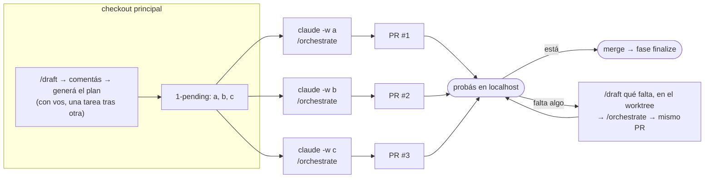
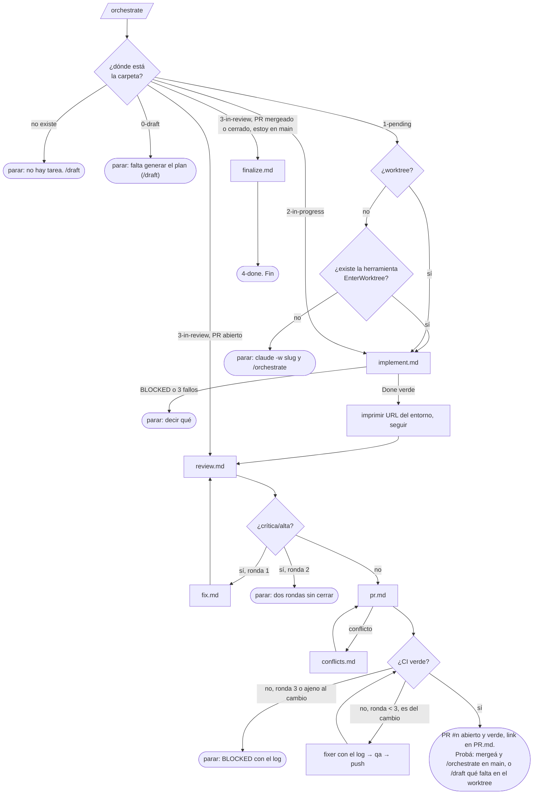

# Orquestar: el flujo entero sin invocar cada comando

Lo corre `/mindstack:orchestrate`. Es el único que ejecuta las fases implement, consensus, review, fix, pr, conflicts y finalize: no son comandos, son referencias que lee en orden. Se detiene solo donde hace falta una persona. **En el worktree termina con el PR abierto, CI verde y el link. En `main`, con el PR mergeado o cerrado, cierra la tarea (fase finalize). Nunca mergea.**

## El modelo de uso

Lo que necesita diálogo con vos (entender el pedido, pedir el plan) pasa en el checkout principal, de a una tarea. Lo que no (implementar, testear, revisar, corregir, abrir el PR) corre en paralelo, un worktree por tarea, un orquestador en cada uno. Desde `1-pending/` el orquestador no vuelve a preguntarte salvo consenso sin acuerdo o ronda 2 con críticas. Vos aparecés al final: probás, y mergeás o iterás.

## Responsabilidades

Desde que la persona dice "hacelo" hasta que entrega, el orquestador es responsable de que esto sea cierto. No es "corrí los comandos": es "el resultado está".

| Es suyo | Cómo lo asegura | Cuándo no puede |
|---|---|---|
| la tarea sale de `1-pending` y llega a `3-in-review` con PR | las fases en orden, leyendo cada reference | nunca: si una fase para, dice dónde y por qué |
| todas las líneas de `TODO.md` con `[x]` y Done verde | el loop no termina sin eso; tres fallos en la misma tarea = parar y decir | `BLOCKED:` o consenso sin acuerdo |
| cada tarea tiene sus tests, escritos por `qa` | lanza `qa` después de cada tarea | nunca |
| los tres `REVIEW-*.md` sin crítica ni alta | revisar ↔ corregir hasta dos rondas | ronda 2 con crítica: la persona |
| el PR abierto, con link en `PR.md` y en el CHANGELOG | `pr.md` | nunca |
| el PR sin conflicto con `main` | `conflicts.md` | intenciones incompatibles: la persona |
| **CI verde** | espera los checks; rojo = `fixer` con el log, `qa`, push; hasta tres rondas | fallo ajeno al cambio o tercera ronda: `BLOCKED` con el log |
| el entorno local levantado y la URL en el CHANGELOG | `env-up.sh` al terminar el loop | sin compose: el comando del stack |
| todo lo que pasó, escrito | Cambios, Decisiones, Deuda, Revisión, Conflictos en el CHANGELOG | nunca |

Lo que no es suyo: escribir SPEC y PLAN (eso es `/draft`), decidir un consenso sin acuerdo, mergear. Eso es de la persona, y el orquestador para ahí y lo dice con el estado exacto. Finalizar sí es suyo: la persona lo corre en `main` después del merge y él cierra.

## Reglas

| Regla | Por qué |
|---|---|
| El estado es la carpeta. El orquestador detecta dónde está y sigue desde ahí; no asume | se puede cortar y retomar en otra sesión |
| Una tarea hija (`padre:` en el PLAN) corre igual; en `fase pr` detecta el PR del padre y lo actualiza en vez de abrir otro | iterar sobre un PR es el mismo flujo, no uno aparte |
| Lee `references/<fase>.md` y hace exactamente eso. No tiene lógica propia | una sola fuente para el modo manual y el orquestado |
| No planifica: arranca desde `1-pending/`. En `0-draft/` para y dice que falta el plan | el plan es el contrato; se escribe en la conversación de `/draft`, con la persona |
| Implementar solo en worktree. Si la herramienta `EnterWorktree` existe, entra solo (el hook `WorktreeCreate` arma el entorno); si no, para y dice `claude -w <slug>` | el checkout principal no se toca |
| No espera a que la persona pruebe: imprime la URL del entorno y sigue a revisión | la autonomía es el punto. La persona prueba cuando quiere en `localhost`; lo que quiera cambiar lo pide en la sesión antes de `fase pr` o después como tarea nueva |
| Máximo 2 rondas revisar↔corregir, máximo 3 rondas de CI | dos modelos discutiendo un `media` hasta que se acaba el presupuesto; tres CI rojos seguidos no son el código |
| Nunca mergea, nunca pushea a `main` (finalize es un commit local en `main`; el push lo hace la persona) | el merge es el único punto donde una persona ve el cambio entero |
| Cada parada dice: estado actual, qué falta, qué comando sigue | la persona retoma sin leer el historial |

## Libertad para terminar

El orquestador no pide permiso entre fases ni dentro de ellas: solo para en los nodos de la persona del diagrama. Commitea cada ronda de borrador y cada movimiento de estado sin preguntar, lanza los agentes que cada fase pide, repite revisar ↔ corregir hasta el tope, y abre el PR. Si el host le pide confirmación por cada `git`, el proyecto no está instalado del todo: `/mindstack:install` deja la lista de permisos en `.claude/settings.json`.

## Commits y push

Invocar `/mindstack:orchestrate` es el pedido explícito de todos los commits y push que las fases por las que pasa declaran (`aprobar`, `implementar`, `revisar`, `corregir`, `pr`, `conflictos`). Lo dice la `description` del comando; si la persona no quiere eso, usa los comandos de a uno.
