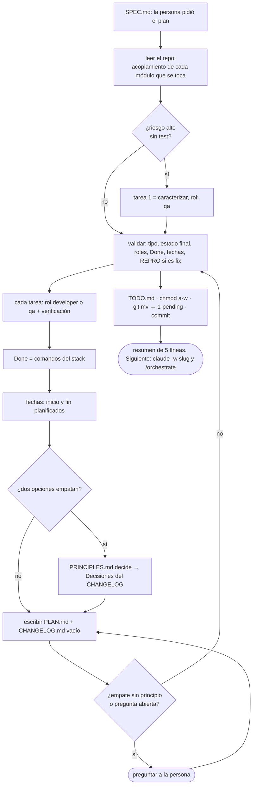

# Planificar: del SPEC al PLAN

Lo corre `/mindstack:plan`, o la misma conversación de `/mindstack:draft` cuando la persona pide el plan en palabras ("generá el plan"); es lo mismo. Requiere `docs/plans/0-draft/<slug>/SPEC.md` de la tarea activa; si no está, pará y decí que primero va `/mindstack:draft`. Pedir el plan es decir que el SPEC está: si al leerlo ves algo que no cierra, decilo antes de planificar. **Termina con la tarea en `1-pending/`**: el plan es la checklist del orquestador, no un documento que la persona aprueba; lo que sí lee es el resumen final. Termina con `PLAN.md` y `CHANGELOG.md` (esqueleto) al lado del SPEC. No implementa nada.

## Pasos

1. **Leer el SPEC entero.** Objetivo, alcance, cada CB. El plan no agrega alcance: si al leer el código ves que falta algo, va a "Fuera de alcance" o a Preguntas abiertas, y la persona decide si vuelve al SPEC.
2. **Acoplamiento.** Para cada módulo que el cambio toca: quién lo importa, quién lo llama, si tiene test y de qué capa. Primero el grafo (`graphify query`, `graphify path`) si existe `graphify-out/graph.json`; confirmá con `grep` lo que el grafo marque como inferido. Sin grafo, `grep -rn` por el nombre exportado. Riesgo alto = muchos callers o lógica de negocio, y sin test. Si investigaste algo para decidir (un spike, una comparación), el detalle va a `notes/<tema>.md` en la carpeta de la tarea y el plan lo linkea.
2a. **Tipo de tarea y skills.** En el frontmatter, `tipo:` dice qué clase de tarea es y `skills:` qué prácticas del plugin carga el `developer` (además de las del stack). Es la forma de que la práctica correcta llegue al rol correcto sin que nadie la adivine:

| `tipo` | `skills` que van | Qué cambia en el plan |
|---|---|---|
| `feature` | las que apliquen: `mindstack:api-design` si expone una frontera, `mindstack:observability` si agrega un camino que puede fallar en producción, `mindstack:documentation` si cambia algo que un usuario necesita saber | nada especial |
| `fix` | `mindstack:debugging`; `mindstack:qa` y `mindstack:tdd` las carga `qa` siempre | Diagnóstico en el SPEC, causa raíz confirmada, tarea 1 = test en rojo (ver 2b) |
| `refactor` | `mindstack:simplification` | sin cambio de comportamiento: `qa` caracteriza antes y la suite es el Done; el SPEC dice qué queda igual |
| `migration` | `mindstack:migration` | "Riesgos y vuelta atrás" obligatoria; expandir y contraer son tareas separadas; `qa` caracteriza antes |
| `performance` | `mindstack:performance` | métrica actual y objetivo como criterio de aceptación verificable; medir antes y después es tarea |
| `ci` | `mindstack:ci-cd` (+ `mindstack:docker-ci` si aplica) | el Done corre en CI, no solo local |
| `docs` | `mindstack:documentation` | sin código; `qa` verifica que los ejemplos corran |

Si una tarea mezcla dos tipos (feature con migración), elegí el más riesgoso como `tipo` y poné las dos skills.

2b. **Si es un fix: confirmar la causa.** El SPEC trae una causa probable; vos leés el código y la confirmás o refutás, con `archivo:línea` y por qué, en "Acoplamiento". Refutada y el alcance no cambia: Decisiones con la causa real. Refutada y el alcance cambia: pará, vuelve a `/mindstack:draft`. Las tareas de un fix tienen orden fijo: 1) `qa` lleva el test de `notes/repro.md` a la suite, al nivel de la causa confirmada, y queda en rojo; 2) `developer` arregla; el Done incluye ese test en verde. Si la reproducción fue manual y ningún test automático es viable, lo decís en Decisiones con principio y queda en Deuda técnica con vencimiento; nunca "arreglado, confiá".
3. **Caracterizar antes de tocar.** Una fila de riesgo alto sin test convierte la primera tarea en tests de caracterización, rol `qa`. Marcá la decisión en el plan.
4. **Tajadas verticales.** Una tarea = un camino completo que se puede probar (schema + api + ui de *una* cosa), no una capa entera. Mal: "toda la DB, toda la API, toda la UI". Bien: "el usuario puede X", "el usuario puede Y". Cada tajada deja el sistema funcionando.
5. **Cada tarea** tiene número, rol (`developer` o `qa`), y verificación (un comando o un test que dice que está). Las de tests van a `qa`, nunca al que implementa. Una tarea que no entra en una iteración del loop son dos. Dibujá el grafo de dependencias entre tareas (flowchart) si son más de cuatro.
6. **Estado final** = Criterios de aceptación del SPEC + lo que el plan agrega (cobertura del diff, lint, docs). Cada línea verificable.
7. **Done** = los comandos del stack que el loop corre para parar. Salen de la skill del stack o del `CLAUDE.md` del proyecto. Todos, no alguno. **Done tiene que correr lo mismo que CI**: mirá `.github/workflows/` (o equivalente) y si CI corre un check que el Done no, agregalo. Un Done más chico que CI es un PR rojo asegurado.
8. **Fechas.** `fecha_inicio` y `fecha_fin` planificadas, en el frontmatter. Son una estimación honesta, no un compromiso: las reales van en `CHANGELOG › Cierre` y la diferencia es información, no culpa.
8b. **Pre-planes.** Si una skill del plugin trae un `PLAN.md` de referencia para el tema (ej. `mindstack:auth-jwt-sessions`), partí de él: copiá sus tareas y decisiones al plan, completá los `TODO` con el repo, y lo que el proyecto decida distinto va a Decisiones con la alternativa. Es orientativo: si no aplica, decilo y armá el plan desde la plantilla.
9. **Empates.** Dos formas de partir las tareas, dos lugares para un módulo: decide `${CLAUDE_PLUGIN_ROOT}/PRINCIPLES.md`, y la elección va a Decisiones del `CHANGELOG.md` con el principio. Sin principio que la respalde, es gusto: preguntá.
10. **CHANGELOG.md**: título y secciones vacías desde `../templates/CHANGELOG.md`. Lo que viste al leer el repo y no es de esta tarea va a Observaciones, quién `planner`.
11. **Preguntas, solo las necesarias.** Un empate sin principio o una pregunta abierta del SPEC que cambie el plan se pregunta ahora; todo lo demás se decide y queda en Decisiones. No se pide "¿está bien el plan?": el plan es técnico.
12. **Commit.** `plan(<slug>): ronda n` con PLAN.md y CHANGELOG.md.
13. **A pendiente, en el mismo turno.** Validá y mové:
    - `tipo:` es uno de la tabla; cada línea de "Estado final" es verificable; cada tarea tiene `rol:` y verificación; Done es un bloque bash no vacío que cubre lo que corre CI; `fecha_inicio` y `fecha_fin` están.
    - Si el SPEC tiene "Diagnóstico": Reproducción no está vacía ni es `NO`, "Causa raíz: confirmada", tarea 1 con rol `qa`. Sin eso, un fix no pasa a pendiente.
    - Preguntas abiertas del SPEC que quedaron: a "Riesgos y vuelta atrás" del PLAN.
    - `TODO.md` desde `../templates/TODO.md`: una línea por tarea, mismo número, rol y verificación, sin tachar.
    - `chmod a-w SPEC.md PLAN.md` (cosmético; la red real es el hook y CI).
    - `git mv docs/plans/0-draft/<slug> docs/plans/1-pending/<slug>`; commit propio `plan(<slug>): pending`.
14. **Resumen de cinco líneas**, lo único que la persona lee: tipo y skills; N tareas y fechas; Done; qué agregaste a "Fuera de alcance" que no estaba en el SPEC; riesgos. Y el siguiente paso: `claude -w <slug>` y `/mindstack:orchestrate` ahí. Si quiere cambiar algo: `/mindstack:draft` sin texto la vuelve a borrador.

## Qué no

- Tachar nada, poner `pr:` ni `entorno:` en el PLAN. Eso lo hacía el flujo viejo y rompía la inmutabilidad; ahora el avance va a `TODO.md` y lo demás a `CHANGELOG.md`.
- Dejar la tarea en `0-draft/` con el plan escrito. Plan hecho es tarea pendiente; si no se pudo validar, se dice qué falta.
- Un plan sin Done ejecutable. "Que funcione" no es Done.
