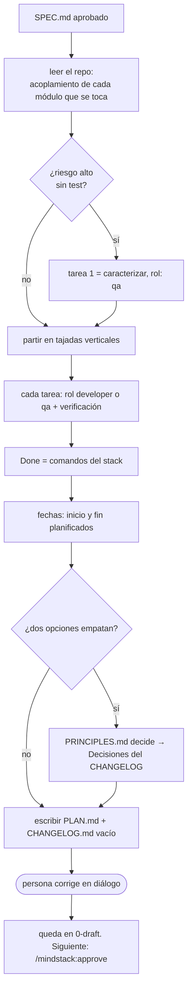

# Planificar: del SPEC al PLAN

Lo corre `/mindstack:plan <slug>` en la sesión principal, en diálogo. Requiere `docs/plans/0-draft/<slug>/SPEC.md`; si no está, pará y decí que primero va `/mindstack:analyze`. Termina con `PLAN.md` y `CHANGELOG.md` (esqueleto) al lado del SPEC. No implementa nada.

## Pasos

1. **Leer el SPEC entero.** Objetivo, alcance, cada CB. El plan no agrega alcance: si al leer el código ves que falta algo, va a "Fuera de alcance" o a Preguntas abiertas, y la persona decide si vuelve al SPEC.
2. **Acoplamiento.** Para cada módulo que el cambio toca: quién lo importa, quién lo llama, si tiene test y de qué capa. Primero el grafo (`graphify query`, `graphify path`) si existe `graphify-out/graph.json`; confirmá con `grep` lo que el grafo marque como inferido. Sin grafo, `grep -rn` por el nombre exportado. Riesgo alto = muchos callers o lógica de negocio, y sin test. Si investigaste algo para decidir (un spike, una comparación), el detalle va a `notes/<tema>.md` en la carpeta de la tarea y el plan lo linkea.
3. **Caracterizar antes de tocar.** Una fila de riesgo alto sin test convierte la primera tarea en tests de caracterización, rol `qa`. Marcá la decisión en el plan.
4. **Tajadas verticales.** Una tarea = un camino completo que se puede probar (schema + api + ui de *una* cosa), no una capa entera. Mal: "toda la DB, toda la API, toda la UI". Bien: "el usuario puede X", "el usuario puede Y". Cada tajada deja el sistema funcionando.
5. **Cada tarea** tiene número, rol (`developer` o `qa`), y verificación (un comando o un test que dice que está). Las de tests van a `qa`, nunca al que implementa. Una tarea que no entra en una iteración del loop son dos. Dibujá el grafo de dependencias entre tareas (flowchart) si son más de cuatro.
6. **Estado final** = Criterios de aceptación del SPEC + lo que el plan agrega (cobertura del diff, lint, docs). Cada línea verificable.
7. **Done** = los comandos del stack que el loop corre para parar. Salen de la skill del stack o del `CLAUDE.md` del proyecto. Todos, no alguno.
8. **Fechas.** `fecha_inicio` y `fecha_fin` planificadas, en el frontmatter. Son una estimación honesta, no un compromiso: las reales van en `CHANGELOG › Cierre` y la diferencia es información, no culpa.
8b. **Pre-planes.** Si una skill del plugin trae un `PLAN.md` de referencia para el tema (ej. `mindstack:auth-jwt-sessions`), partí de él: copiá sus tareas y decisiones al plan, completá los `TODO` con el repo, y lo que el proyecto decida distinto va a Decisiones con la alternativa. Es orientativo: si no aplica, decilo y armá el plan desde la plantilla.
9. **Empates.** Dos formas de partir las tareas, dos lugares para un módulo: decide `${CLAUDE_PLUGIN_ROOT}/references/PRINCIPLES.md`, y la elección va a Decisiones del `CHANGELOG.md` con el principio. Sin principio que la respalde, es gusto: preguntá.
10. **CHANGELOG.md**: título y secciones vacías desde `../templates/CHANGELOG.md`. Lo que viste al leer el repo y no es de esta tarea va a Observaciones, quién `planner`.
11. **Diálogo.** Mostrá el plan, preguntá, corregí, hasta que la persona diga que está. Las correcciones se hacen acá, porque después del `/mindstack:approve` el archivo no se toca.

## Qué no

- Tachar nada, poner `pr:` ni `entorno:` en el PLAN. Eso lo hacía el flujo viejo y rompía la inmutabilidad; ahora el avance va a `TODO.md` y lo demás a `CHANGELOG.md`.
- Mover a `1-pending/`. Lo hace `/mindstack:approve`, cuando la persona lo pide.
- Un plan sin Done ejecutable. "Que funcione" no es Done.
