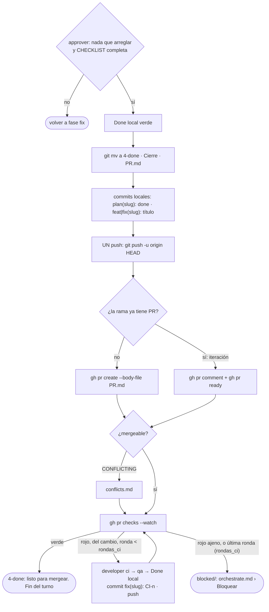

# PR: llegar a done

Lo corre el orquestador (fase pr). Requiere la carpeta en `3-in-review/`, cada hallazgo de la última ronda con decisión del approver, nada que arreglar abierto y `CHECKLIST.md` completa. Es el único punto donde el código se commitea: hasta acá vivió en el working tree. Termina con la tarea en `4-done/`: **todo commiteado, PR abierto y CI verde. Lista para mergear.** No mergea.

## Pasos

Si la carpeta ya está en `4-done/` (se retomó de `blocked/`, una cola cortada, o CI quedó pendiente en otra sesión), el código ya está commiteado. Si la rama está adelante de su remoto (`git status -sb`, o no tiene remoto), seguí desde el paso 5 (push); si no, desde el 6.

**En una cola** (`orchestrate.md › Cola`) se parte en dos: cada hija hace los pasos 1 a 4 para su tarea y termina con commit local; el padre hace del 5 en adelante una sola vez para toda la cola, con el body armado de los `PR.md` de cada tarea.

1. Verificá: carpeta en `todolist/3-in-review/<slug>/`; la última ronda de `APPROVAL.md` dice `APPROVAL: pr` (o, en `quick`, la última revisión no tuvo hallazgos); todas las líneas de `CHECKLIST.md` con `[x]`. Si no, volvé a `fix.md`.
2. Done de `PLAN.md` pasa ahora. Si no, volvé a `fix.md` con el log como hallazgo.
3. **La carpeta llega a done antes del push**, en el working tree:
   - `git mv todolist/3-in-review/<slug> todolist/4-done/<slug>`.
   - `CHANGELOG › Cierre`: inicio real (fecha del commit `plan(<slug>): implement`), fin real (hoy), al lado las planificadas; rondas de revisión; qué quedó distinto de lo planeado (dos o tres líneas de Decisiones); deuda abierta de `TECHNICAL_DEBT.md`, con issue y vencimiento.
   - `PR.md` desde `../templates/PR.md`: Objetivo en pasado, la `CHECKLIST` con su evidencia, cómo probar cada CB, resumen de rondas, lo que la persona tiene que mirar.
   - **Backlog**, ahora y no antes (lo pedido ya está revisado y el commit `plan(<slug>): done` lo lleva en el PR): las filas de `CHANGELOG › Propuestas` y `REVIEW-*.md › Propuestas` que traen dónde se vio pasan a `todolist/backlog/PROPUESTAS.md`, con el formato y la deduplicación de `../templates/PROPUESTAS.md`. Máximo `propuestas_por_tarea` nuevas, las de más valor. `IDEAS.md` no se toca.
4. Commits, todos locales: `plan(<slug>): done` con `git add todolist/` (la carpeta movida con `TODO.md`, `CHANGELOG.md` y `PR.md`, y `backlog/PROPUESTAS.md`), y si queda código sin commitear, `feat(<slug>): <title del PLAN>` (o `fix(`) con `git add -A`. El código ya viene en los `wip` de implement y fix (`git.md`).
5. **Un solo push**: `git push -u origin HEAD`. CI corre una vez por push, no por commit; por eso nada se commitea entre abrir el PR y que CI termine.
6. ¿La rama ya tiene un PR (`gh pr view`)?
   - No: `gh pr create --title "<title del PLAN>" --body-file todolist/4-done/<slug>/PR.md --base main`. Se mergea con *squash* (`PR.md` lo dice): el título del PR es el commit que entra a `main`.
   - Sí, es una iteración (`iterate.md`): `gh pr comment` con el resumen de la iteración y `gh pr ready` (la iteración lo había pasado a draft).
   El número y el link del PR no se escriben en ningún archivo: salen de `gh pr view` sobre la rama. Escribirlos sería un commit más, y otra corrida de CI.
7. `gh pr view --json mergeable`: si dice `CONFLICTING`, `conflicts.md` (se corre solo en modo orquestado; a mano, `/mindstack:rebase`). Conflicto con intenciones incompatibles → `blocked`.
8. **CI verde es parte de done**: `gh pr checks --watch`.
   - Verde: fin. La tarea está en `4-done/` y el turno termina con el link.
   - Rojo, y el log muestra que es del cambio: `Agent developer` con `ci <slug> <run>` → `Agent qa` con `testear <slug> ci <run>` sobre lo que cambió → Done local → commit `fix(<slug>): CI-n <qué>` → push → volver a mirar. La carpeta no se mueve: ya está en `4-done` y el commit del arreglo dispara CI igual.
   - Rojo por algo ajeno al cambio (infra, secreto que falta, test inestable de otro módulo), o la última ronda de CI roja (`rondas_ci`): `blocked` (`orchestrate.md › Bloquear`). Con un conflicto incompatible (paso 7), son los únicos casos en que la carpeta sale de `4-done`.

Reglas del paso 8:
- Cada fallo es un `CI-n` en `CHANGELOG › Revisión`, con decisión `arreglar` o `bloqueado` y el motivo (la línea del log).
- Si CI falló por algo que el Done de `PLAN.md` no corre, fila en Observaciones: "Done incompleto: CI corre X y el plan no".
- El `developer` en modo `ci` corrige lo que el log dice, nada más. No se relanzan los revisores por un fix de CI: ya vieron el código, y el fix toca solo lo que el log dice.
- Tope: `rondas_ci` (`config.sh`). Si el Done local es igual a CI, varios rojos seguidos son el entorno, no el código.

Terminá con el link del PR y "CI verde: listo para mergear". El merge lo hace la persona; no hay nada que correr después. La limpieza del entorno y del worktree la sugiere el aviso de sesión cuando la tarea ya está mergeada.

## Qué queda si el PR desaparece

Un PR en GitHub no se borra: se cierra. Lo que puede desaparecer es la rama. La carpeta de la tarea vive en la rama hasta el merge:

| Caso | Código | SPEC, PLAN, CHANGELOG, REVIEWs |
|---|---|---|
| mergeado | en `main` | en `main`, en `todolist/4-done/<slug>/` |
| cerrado sin merge, rama viva | en la rama | en la rama |
| cerrado sin merge, rama borrada | perdido | perdido; el PR cerrado sigue en GitHub con su diff, que incluye la carpeta |

## Qué no

- Mergear, ni con `--auto`. El merge es el único punto donde una persona ve el cambio entero.
- Commitear algo después de abrir el PR que no sea un arreglo de CI, la resolución de un conflicto (`conflicts.md`) o un movimiento a `blocked/` y de vuelta (`orchestrate.md › Bloquear`, `Retomar`). Cada push es una corrida más.
- `[skip ci]` en un commit: si el repo tiene checks obligatorios, quedan pendientes para siempre y el PR no se puede mergear.
- Abrir un segundo PR sobre la misma rama.
- Terminar con CI rojo o pendiente. El hook de parada no lo deja.
