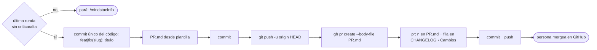

# PR: abrir el pull request

Lo corre `/mindstack:pr <slug>`. Requiere la carpeta en `3-in-review/` y que la última ronda de revisión no tenga crítica ni alta abierta. Es el único punto donde el código se commitea: hasta acá vivió en el working tree. Termina con el PR abierto y su número en `PR.md` y en `CHANGELOG.md`. **No mergea.**

## Pasos

1. Verificá: carpeta en `docs/plans/3-in-review/<slug>/`; `CHANGELOG › Revisión` tiene al menos una ronda y ningún hallazgo crítica/alta sin `corregido`. Si la persona quiere abrir igual con algo abierto, que lo diga explícitamente y queda en Decisiones.
2. Done de `PLAN.md` pasa ahora. Si no, pará.
2b. **El commit del código.** `git add -A` y un commit `feat(<slug>): <title del PLAN>` (o `fix(` si es un fix) con el código, los tests, `TODO.md` y `CHANGELOG.md`. Es el primer commit de código de la rama: todo lo anterior fueron docs. Si preferís commits por tarea para leer el historial, no: la unidad revisada es el conjunto, y ese es el commit.
3. `PR.md` desde `../templates/PR.md`: Objetivo en pasado, Estado final con cada casilla y su evidencia del CHANGELOG, cómo probar cada CB, resumen de rondas, lo que la persona tiene que mirar. Commit `plan(<slug>): PR`.
4. `git push -u origin HEAD`.
5. `gh pr create --title "<title del PLAN>" --body-file docs/plans/3-in-review/<slug>/PR.md --base main`.
6. `pr: <n>` al final de `PR.md`, fila en `CHANGELOG › Cambios` (quién `person`, qué "PR #n abierto"). Commit, push.
7. Si `gh pr view <n> --json mergeable` dice `CONFLICTING`: decilo y sugerí `/mindstack:conflicts <slug>`.

Terminá diciendo el número del PR y que el merge lo hace la persona; después del merge, `/mindstack:finalize <slug>` en main.

## Qué no

- Mergear, ni con `--auto`. El merge es el único punto donde una persona ve el cambio entero.
- Editar el body después de abierto. Lo que cambia va al CHANGELOG.
