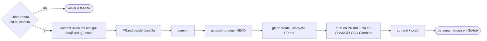
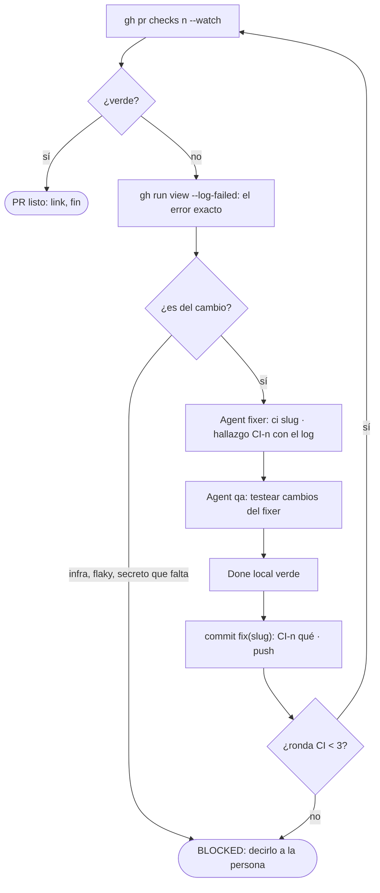

# PR: abrir el pull request

Lo corre el orquestador (fase pr). Requiere la carpeta en `3-in-review/` y que la última ronda de revisión no tenga crítica ni alta abierta. Es el único punto donde el código se commitea: hasta acá vivió en el working tree. Termina con el PR abierto y su número en `PR.md` y en `CHANGELOG.md`. **No mergea.**

## Pasos

1. Verificá: carpeta en `docs/plans/3-in-review/<slug>/`; `CHANGELOG › Revisión` tiene al menos una ronda y ningún hallazgo crítica/alta sin `corregido`. Si la persona quiere abrir igual con algo abierto, que lo diga explícitamente y queda en Decisiones.
2. Done de `PLAN.md` pasa ahora. Si no, pará.
2b. **El commit del código.** `git add -A` y un commit `feat(<slug>): <title del PLAN>` (o `fix(` si es un fix) con el código, los tests, `TODO.md` y `CHANGELOG.md`. Es el primer commit de código de la rama: todo lo anterior fueron docs. Si preferís commits por tarea para leer el historial, no: la unidad revisada es el conjunto, y ese es el commit.
3. `PR.md` desde `../templates/PR.md`: Objetivo en pasado, Estado final con cada casilla y su evidencia del CHANGELOG, cómo probar cada CB, resumen de rondas, lo que la persona tiene que mirar. Commit `plan(<slug>): PR`.
4. `git push -u origin HEAD`.
4b. **Si la rama ya tiene un PR abierto** (`gh pr list --head $(git branch --show-current)`): es una iteración (`skills/workflow/references/iterate.md`). No abras otro: push, `gh pr comment <n>` con el resumen de la iteración, `pr:` y `url:` del padre en el `PR.md` de la hija, fila en Cambios, commit, push. Terminá ahí.
5. `gh pr create --title "<title del PLAN>" --body-file docs/plans/3-in-review/<slug>/PR.md --base main`. Guardá la URL que imprime.
6. Al final de `PR.md`: `pr: <n>` y `url: https://github.com/<org>/<repo>/pull/<n>`. Fila en `CHANGELOG › Cambios` (quién `person`, qué "PR #n abierto", evidencia = la URL). Commit, push. El link directo queda en los dos archivos, y los dos viajan con el repo.
7. Si `gh pr view <n> --json mergeable` dice `CONFLICTING`: `skills/workflow/references/conflicts.md` (en modo orquestado se corre solo; a mano, sugerí `/mindstack:rebase`).
8. **CI verde es parte del trabajo.** El PR no está "abierto" hasta que sus checks pasan:

   - Cada fallo es un hallazgo `CI-n` en `CHANGELOG › Revisión` (rol `ci`), con resultado `corregido` o `bloqueado: motivo`.
   - Si CI falló por algo que el Done de `PLAN.md` no corre, además una fila en Observaciones: "Done incompleto: CI corre X y el plan no". El próximo plan lo incluye.
   - El `fixer` corrige lo que el log dice, nada más. No se relanzan los tres revisores por un fix de CI: ya vieron el código; CI es una compuerta mecánica. Si el fix toca más que el check que falló, sí: `review.md`, ronda nueva.
   - Tope: tres rondas de CI. A la cuarta, para y lo dice: tres fallos seguidos es un problema del entorno o del plan, no del código.

Terminá diciendo el número del PR, el link, y que CI está verde. El merge lo hace la persona; después del merge, `/mindstack:orchestrate` en `main` (fase finalize) en main.

## Qué queda si el PR desaparece

Un PR en GitHub no se borra: se cierra. Lo que puede desaparecer es la rama. Qué sobrevive, en cada caso:

| Caso | Código | SPEC, PLAN, CHANGELOG, REVIEWs | Link |
|---|---|---|---|
| mergeado | en `main` | en `main`, en `docs/plans/4-done/<slug>/` después de `fase finalize` | `PR.md › url` y `CHANGELOG › Cierre`, siguen abriendo el PR cerrado |
| cerrado sin merge, rama viva | en la rama | en la rama | ídem |
| cerrado sin merge, rama borrada | perdido | **perdido, salvo lo que ya estaba en `main`**: SPEC y PLAN aprobados (el `/approve` fue un commit en `main`) | el PR cerrado sigue en GitHub con su diff |

Por eso `fase finalize` también cubre el PR cerrado sin merge: trae la carpeta de la tarea desde la rama a `main` antes de que alguien borre la rama. La memoria de la tarea (qué se decidió, qué se dejó, qué dijeron los revisores) vale aunque el código no haya entrado.

## Qué no

- Mergear, ni con `--auto`. El merge es el único punto donde una persona ve el cambio entero.
- Editar el body después de abierto. Lo que cambia va al CHANGELOG y, en una iteración, al comentario del PR.
- Abrir un segundo PR sobre la misma rama.
- Dar por terminado con CI rojo. Un PR rojo es trabajo a medias con un link.
