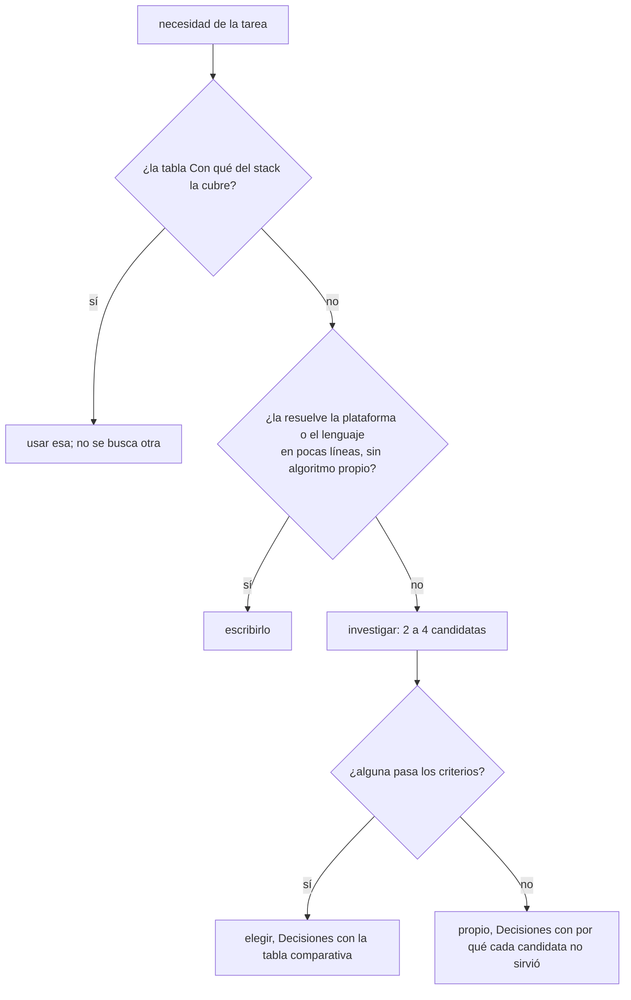

# Buscar antes de construir

Implementar algo propio es la última opción. Si el problema tiene nombre (layout de grafos, editor visual de formularios PDF, drag and drop, virtualización, diff de textos, parseo de fechas en lenguaje natural), alguien ya lo resolvió, lo probó con miles de usuarios y le arregló los casos borde que vos todavía no viste. Escribirlo de cero es pagar ese camino otra vez y quedarse con el mantenimiento. Principio: "Práctico antes que puro" (`../../../PRINCIPLES.md`).



La tabla "Con qué" de cada skill de stack es el tope: lo que está ahí se usa y no se discute. Lo que no está se investiga; no se asume que "no hay" ni se instala la primera que aparece.

## Quién investiga

| Cuándo | Quién | Cómo |
|---|---|---|
| al planificar (lo normal) | la sesión principal lanza `researcher`, uno por necesidad, en paralelo | la elegida queda en la tarea del PLAN ("con `elkjs`") y la tabla en `CHANGELOG › Decisiones`. El developer no la vuelve a discutir |
| durante una tarea, una necesidad que el plan no vio | el `developer`, con `WebSearch` y `WebFetch` | mismos criterios, misma tabla en Decisiones. Si dos candidatas empatan sin principio: `DECISION:` |

Un subagente no puede lanzar otro subagente: por eso el `developer` investiga él mismo y no llama a `researcher`. Quien lanza agentes es la sesión principal (`CLAUDE.md` del plugin, "Command, agent o skill").

## Criterios

| Criterio | Pasa | No pasa |
|---|---|---|
| resuelve la necesidad | el caso de la tarea y sus CB-n, probado en la doc o en un ejemplo oficial | "con un poco de código alrededor" que es la mitad del problema |
| mantenida | release en los últimos 12 meses, issues respondidos | último release hace años, issues de seguridad abiertos |
| trayectoria | usada por proyectos conocidos, descargas semanales altas para su nicho, varios mantenedores o una organización detrás | un autor, cero dependientes, creada el mes pasado |
| licencia | MIT, Apache-2.0, BSD, ISC | GPL/AGPL en código que se distribuye, sin licencia |
| encaja en el stack | tipos incluidos, ESM, corre donde corre la app (browser, Node, worker) | pide `'unsafe-eval'` o inyecta `<style>` sin nonce (`../../web-security/references/csp.md`) |
| costo | tamaño razonable para lo que resuelve, dependencias transitivas pocas | 2 MB para un caso que usa una función |

Datos, no recuerdos: `npm view <pkg> time.modified version license`, la página del repo, el changelog. Lo que el modelo "sabe" de una librería puede tener dos años.

## Lo que queda escrito

```markdown
<!-- valores de ejemplo -->
| Necesidad | Candidata | Release | Descargas/sem | Licencia | Encaja | Elegida |
|---|---|---|---|---|---|---|
| posicionar nodos del diagrama | elkjs | 2026-08 | 1.2M | EPL-2.0 | worker, tipos | sí: layered + puertos |
| | dagre | 2023-01 | 900k | MIT | sí | no: sin mantenimiento |
```

Va en `CHANGELOG › Decisiones` con el principio. El revisor de código marca como hallazgo un algoritmo o componente propio sin esa tabla.
