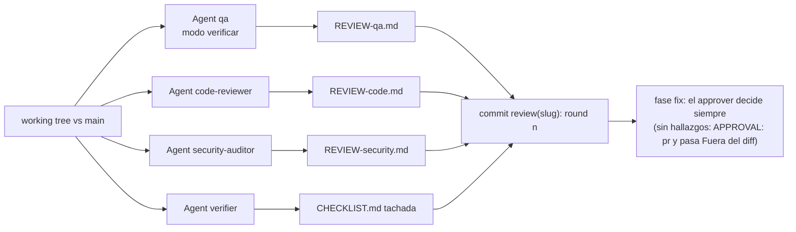

# Revisar: cuatro roles (dos en `quick`), un turno

Lo corre el orquestador (fase review). Requiere `TODO.md` completo y Done verde. El código todavía no está commiteado: se revisa el working tree contra la base (`git diff main`), no un rango de commits. La primera ronda mueve la carpeta a `3-in-review/`; las siguientes la encuentran ahí. Termina con `REVIEW-qa.md`, `REVIEW-code.md`, `REVIEW-security.md` y `CHECKLIST.md` escritos y commiteados.

Por qué cuatro agentes y no uno: un revisor que mira todo mira todo por encima. Tres miran **cómo** está hecho (tests, código, seguridad) y uno mira **si** está hecho: el `verifier` recorre la checklist línea por línea y no tacha sin código, test y evidencia. Por qué en un solo turno: corren en paralelo, no se leen entre sí, y lo que escriben no se pisa porque cada uno tiene su archivo y el hook se lo garantiza.

## Precondiciones

- Carpeta en `2-in-progress/` o `3-in-review/` (también la ronda 1 después de Retomar). Si está en otra, pará.
- Todas las líneas de `TODO.md` con `[x]`. Si no, volvé a `implement.md`: la revisión es de la tarea entera.
- Done de `PLAN.md` pasa ahora. Si no, volvé a `implement.md` con el log como una tarea más.
- Ronda = commits `review(<slug>): round n` desde el último `plan(<slug>): unblocked` (o desde el principio), + 1; sin commits, 1. Se cuenta por commit porque una ronda limpia no deja filas en Revisión.

## Pasos

1. Si la carpeta está en `2-in-progress/`: `git mv` a `3-in-review/<slug>`, commit propio `plan(<slug>): in review`.
2. La base es `git fetch origin && git merge-base origin/main HEAD` (no el `main` local, que puede estar viejo). Lo que se revisa es `git diff <base>` (lo commiteado y lo que no) más `git status --short` para los archivos nuevos. Cada revisor recibe esa base en el prompt. Desde la ronda 2, `qa`, `code-reviewer` y `security-auditor` reciben además `solo: <archivos>` (los que tocaron developer y qa en la fase fix) y los IDs que se mandaron a arreglar (`APPROVAL.md › Ronda n-1 › Para corregir`): revisan eso y anotan en la sección "Cerrados" del REVIEW si cada ID se cerraron, no vuelven a revisar lo que ya pasó. El `verifier` recorre la checklist entera siempre: es barato y un arreglo puede romper una línea ya tachada.
3. **Cuántos revisores.** Con `camino: quick` en el SPEC, y si el diff no toca un área de riesgo ni pasa `quick_max_lineas` (`analyze.md › Camino`): dos, `code-reviewer` (con la pasada de seguridad: "cargá también `mindstack:security`") y `verifier`. Si no: los cuatro. **Un solo turno**, cada `Agent` con `subagent_type` del rol y este prompt mínimo:
   - `qa`: "verificar <slug> ronda <n> base <base>. Por cada CB-n de SPEC.md: ¿hay un test que lo nombra y lo cubre? Un hallazgo por CB sin test o con test que no lo reproduce. Escribí REVIEW-qa.md. No escribas tests. Máximo <hallazgos_por_revisor> hallazgos."
   - `code-reviewer`: "revisar <slug> ronda <n> base <base>. Lógica, legibilidad, arquitectura, rendimiento. Escribí REVIEW-code.md. Máximo <hallazgos_por_revisor> hallazgos."
   - `security-auditor`: "auditar <slug> ronda <n> base <base>. Zero trust. Escribí REVIEW-security.md. Máximo <hallazgos_por_revisor> hallazgos."
   - `verifier`: "verificar <slug> ronda <n>. Tachá CHECKLIST.md con evidencia."
4. Cuando terminan: un commit `review(<slug>): round <n>` **solo con los `REVIEW-*.md` y `CHECKLIST.md`** (`git add` de esos archivos, nada más).
5. Fase fix (`fix.md`): el `approver` decide, también cuando no hay hallazgos (devuelve `APPROVAL: pr` y pasa "Fuera del diff" a Observaciones). Con `camino: quick`, ningún hallazgo y la checklist completa, se saltea el approver: el orquestador pasa "Fuera del diff" a Observaciones y sigue con `pr.md`. El tope de rondas lo resuelve `fix.md`.

## Qué no

- Correr los agentes de a uno. Pierden independencia y tiempo.
- Un revisor que escribe el archivo de otro, o alguien que no es `verifier` tachando la checklist. El hook lo bloquea; si pasa, es un bug del hook.
- Corregir o decidir nada en esta fase. Lo que se encontró lo decide el approver en la fase fix.
