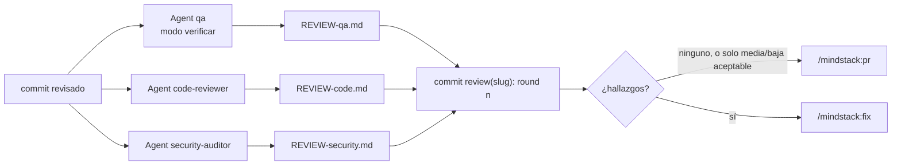

# Revisar: tres roles, tres archivos, un turno

Lo corre `/mindstack:review <slug>`. Requiere `TODO.md` completo y Done verde. La primera ronda mueve la carpeta a `3-in-review/`; las siguientes la encuentran ahí. Termina con `REVIEW-qa.md`, `REVIEW-code.md` y `REVIEW-security.md` escritos y commiteados.

Por qué tres agentes y no uno: un revisor que mira todo mira todo por encima. Tres con un solo encargo cada uno encuentran lo suyo y no se sesgan entre sí. Por qué en un solo turno: corren en paralelo, no se leen entre sí, y lo que escriben no se pisa porque cada uno tiene su archivo y el hook se lo garantiza.

## Precondiciones

- Carpeta en `2-in-progress/` (ronda 1) o `3-in-review/` (ronda ≥ 2). Si está en otra, pará.
- Todas las líneas de `TODO.md` con `[x]`. Si no, pará: la revisión es de la tarea entera.
- Done de `PLAN.md` pasa ahora. Si no, pará y decí qué falla.
- Ronda = última fila de `CHANGELOG › Revisión` + 1; sin filas, 1.

## Pasos

1. Ronda 1: `git mv docs/plans/2-in-progress/<slug> docs/plans/3-in-review/<slug>`, commit propio `plan(<slug>): in review`.
2. Rango: `git log --oneline main..HEAD` (o la base de la rama). Es lo que se revisa; cada revisor lo recibe.
3. **Un solo turno con tres `Agent`**, cada uno con `subagent_type` del rol y este prompt mínimo:
   - `qa`: "verificar <slug> ronda <n> commits <rango>. Por cada CB-n de SPEC.md: ¿hay un test que lo nombra y lo cubre? Un hallazgo por CB sin test o con test que no lo reproduce. Escribí REVIEW-qa.md. No escribas tests."
   - `code-reviewer`: "revisar <slug> ronda <n> commits <rango>. Lógica, legibilidad, arquitectura, rendimiento. Escribí REVIEW-code.md."
   - `security-auditor`: "auditar <slug> ronda <n> commits <rango>. Zero trust. Escribí REVIEW-security.md."
4. Cuando los tres terminan: un commit `review(<slug>): round <n>` con los tres archivos.
5. Resumen en la salida: por rol, cuántos hallazgos por severidad. Y el veredicto:
   - ninguno, o solo media/baja que la persona acepte como deuda: siguiente paso `/mindstack:pr <slug>`.
   - cualquier crítica o alta: siguiente paso `/mindstack:fix <slug>`.
   - ronda 2 con crítica o alta todavía abierta: pará y pedí a la persona. Dos rondas que no cierran son un desacuerdo, no un bug.

## Qué no

- Correr los agentes de a uno. Pierden independencia y tiempo.
- Un revisor que escribe el archivo de otro. El hook lo bloquea; si pasa, es un bug del hook.
- Corregir nada en este comando. Lo que se encontró se corrige con `/mindstack:fix`, por el corrector, no por el revisor.
