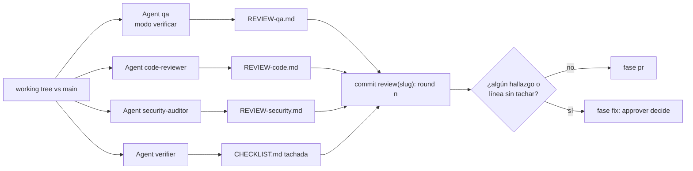

# Revisar: cuatro roles, cuatro archivos, un turno

Lo corre el orquestador (fase review). Requiere `TODO.md` completo y Done verde. El código todavía no está commiteado: se revisa el working tree contra `main` (`git diff main`), no un rango de commits. La primera ronda mueve la carpeta a `3-in-review/`; las siguientes la encuentran ahí. Termina con `REVIEW-qa.md`, `REVIEW-code.md`, `REVIEW-security.md` y `CHECKLIST.md` escritos y commiteados.

Por qué cuatro agentes y no uno: un revisor que mira todo mira todo por encima. Tres miran **cómo** está hecho (tests, código, seguridad) y uno mira **si** está hecho: el `verifier` recorre la checklist línea por línea y no tacha sin código, test y evidencia. Por qué en un solo turno: corren en paralelo, no se leen entre sí, y lo que escriben no se pisa porque cada uno tiene su archivo y el hook se lo garantiza.

## Precondiciones

- Carpeta en `2-in-progress/` (ronda 1) o `3-in-review/` (ronda ≥ 2). Si está en otra, pará.
- Todas las líneas de `TODO.md` con `[x]`. Si no, volvé a `implement.md`: la revisión es de la tarea entera.
- Done de `PLAN.md` pasa ahora. Si no, volvé a `implement.md` con el log como una tarea más.
- Ronda = filas de rondas en `CHANGELOG › Revisión` desde la última vez que la tarea salió de `blocked/`, + 1; sin filas, 1.

## Pasos

1. Ronda 1: `git mv todolist/2-in-progress/<slug> todolist/3-in-review/<slug>`, commit propio `plan(<slug>): in review`.
2. Lo que se revisa es `git diff main` (working tree contra la base), más `git status --short` para ver qué archivos nuevos hay. Cada revisor lo recibe como `base main`. Desde la ronda 2, `qa`, `code-reviewer` y `security-auditor` reciben además `solo: <archivos>` (los que tocaron developer y qa en la fase fix) y los IDs que se mandaron a arreglar: revisan eso y confirman que esos IDs se cerraron, no vuelven a revisar lo que ya pasó. El `verifier` recorre la checklist entera siempre: es barato y un arreglo puede romper una línea ya tachada.
3. **Un solo turno con cuatro `Agent`**, cada uno con `subagent_type` del rol, `model` y `effort` de `config.sh` (`orchestrate.md › Reglas`) y este prompt mínimo:
   - `qa`: "verificar <slug> ronda <n> base main. Por cada CB-n de SPEC.md: ¿hay un test que lo nombra y lo cubre? Un hallazgo por CB sin test o con test que no lo reproduce. Escribí REVIEW-qa.md. No escribas tests. Máximo <hallazgos_por_revisor> hallazgos."
   - `code-reviewer`: "revisar <slug> ronda <n> base main. Lógica, legibilidad, arquitectura, rendimiento. Escribí REVIEW-code.md. Máximo <hallazgos_por_revisor> hallazgos."
   - `security-auditor`: "auditar <slug> ronda <n> base main. Zero trust. Escribí REVIEW-security.md. Máximo <hallazgos_por_revisor> hallazgos."
   - `verifier`: "verificar <slug> ronda <n>. Tachá CHECKLIST.md con evidencia."
4. Cuando los cuatro terminan: un commit `review(<slug>): round <n>` **solo con los tres `REVIEW-*.md` y `CHECKLIST.md`** (`git add` de esos archivos, nada más). El código sigue sin commitear.
5. Veredicto:
   - ningún hallazgo nuevo y `CHECKLIST` completa: fase pr (`pr.md`).
   - si no: fase fix (`fix.md`). Ahí el `approver` decide qué se arregla, qué queda como deuda o riesgo aceptado y qué se descarta.
   - el tope de rondas lo resuelve `fix.md`: en la última, el approver no devuelve `fix`.

## Qué no

- Correr los agentes de a uno. Pierden independencia y tiempo.
- Un revisor que escribe el archivo de otro, o alguien que no es `verifier` tachando la checklist. El hook lo bloquea; si pasa, es un bug del hook.
- Corregir o decidir nada en esta fase. Lo que se encontró lo decide el approver en la fase fix.
