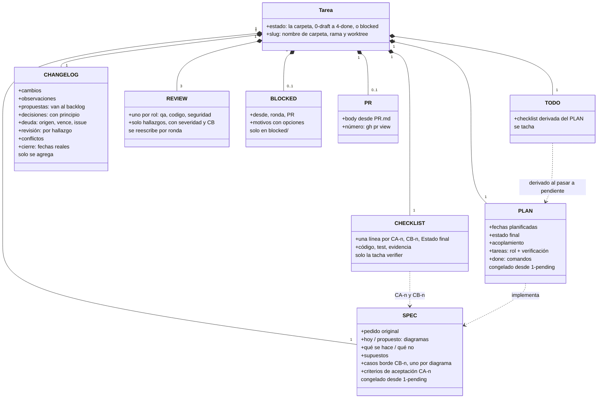
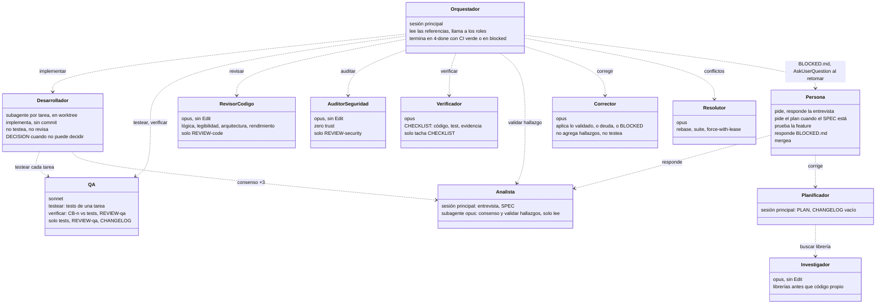

# Roles y artefactos

## Qué hace y qué no cada rol

Cada rol tiene un permiso que le impide hacer el trabajo de otro: el que implementa testea lo que pensó, no lo que el código hace, y un fallo queda en un solo lugar.

| Rol | Hace | No hace | Escribe |
|---|---|---|---|
| **analista** | entrevista, supuestos, casos borde con diagrama, SPEC. En consenso: busca evidencia en historial, código o principios | decidir cómo se implementa | `SPEC.md` |
| **planificador** | acoplamiento, tajadas verticales, tareas con rol y verificación, fechas, Done; valida y deja la tarea pendiente | implementar, tachar, preguntar lo que un principio decide | `PLAN.md`, `TODO.md`, `CHANGELOG.md` vacío |
| **desarrollador** | una tarea por vuelta, sin commit, Cambios, Decisiones, Deuda. Senior: sabe arquitectura y sabe que la perfección no es el objetivo | tests, reviews, refactors grandes, adivinar ambigüedades | código, `TODO.md`, `CHANGELOG.md` |
| **qa** | caja negra: entradas y salidas por la interfaz, sin leer la implementación. En un fix, reproduce el bug antes del plan; tests de cada tarea; en revisión, cruza cada CB-n del SPEC contra los tests | código de producción, leer el cuerpo de las funciones | tests, `REVIEW-qa.md`, `CHANGELOG.md` |
| **researcher** | compara 2 a 4 librerías con datos (release, descargas, licencia, encaje) y recomienda una o "propio" | decidir por recuerdo, instalar | nada |
| **code-reviewer** | lógica, legibilidad, arquitectura, rendimiento | editar, elogiar | `REVIEW-code.md` |
| **security-auditor** | zero trust: toda entrada es hostil hasta que se valida | editar, bajar severidad por "poco probable" | `REVIEW-security.md` |
| **verifier** | cada línea de la checklist: código, test que la nombra, test corrido; tacha solo con las tres | juzgar calidad, escribir código o tests, cambiar líneas | `CHECKLIST.md` |
| **corrector** | cada hallazgo validado: corrige, o deuda con vencimiento si está fuera del alcance; si no puede, `BLOCKED` | agregar hallazgos, rechazar uno validado, tests | código, `CHANGELOG.md` |
| **conflict-resolver** | rebase, suite, `--force-with-lease` | `--force`, "el mío" entero | lo que esté en conflicto, `CHANGELOG.md` |
| **orquestador** | lee las referencias y llama a los roles en orden; mueve a `4-done` o a `blocked/`; filtra las propuestas al backlog | lógica propia, mergear, preguntar en el camino, tocar `IDEAS.md` | `BLOCKED.md`, `PR.md`, Cierre, `backlog/PROPUESTAS.md` |

## Quién invoca a quién

Los roles no se llaman entre sí: los invoca la sesión principal (un comando o `/mindstack:orchestrate`), que es la única que puede lanzar `Agent` y hablar con la persona (qué puede cada tipo: `CLAUDE.md` del plugin, "Command, agent o skill"). Claude Code elige la skill por su `description` (por eso toda description dice "Usar cuando …"); los agentes se eligen por nombre, acá:

| Quién invoca | A quién | Cuándo | Con qué |
|---|---|---|---|
| `/draft (analyze)` | `qa` (`reproducir`) | la tarea es un fix | síntoma + punto de entrada; sin la causa |
| `/plan` | `researcher`, uno por necesidad | una tarea pide un componente o algoritmo que el stack no cubre | la necesidad; `research.md` |
| `orchestrate › implement` | `developer`, después `qa` (`testear`) | después de cada tarea del TODO | slug + número de tarea |
| `orchestrate › implement` | `analyst` ×3 | el dev devolvió `DECISION:` | la pregunta, las opciones, un ángulo cada uno |
| `orchestrate › review` | `qa` (`verificar`), `code-reviewer`, `security-auditor`, `verifier` | TODO completo y Done verde | slug, ronda, base `main` (working tree sin commitear); los cuatro en un turno |
| `orchestrate › fix` | `analyst` (`validar`), uno por hallazgo crítico o alto; ×3 si el validador lo refuta | antes de corregir | slug, ID del hallazgo |
| `orchestrate › fix` | `fixer`, después `qa` (`testear`) | hallazgos validados o checklist abierta | slug, ronda |
| `orchestrate › conflicts` | `conflict-resolver` | el PR está en conflicto | slug o #pr |
| `/mindstack:orchestrate` | las cuatro fases de arriba, en orden | la persona delega el flujo, normalmente desde `1-pending` en un worktree | lee `references/<fase>.md` |
| `/draft "qué falta" (en el worktree)` | `qa` (`reproducir`) si lo que falta es un bug | probaste el PR y falta algo | crea la tarea hija; después `/orchestrate` en el mismo worktree |

## Iteración por fase

El loop no es solo de implementación. Cada fase itera hasta su condición de salida, y la condición es verificable, no "parece que está":

| Fase | Itera | Hasta que |
|---|---|---|
| analizar | pregunta → respuesta → supuestos y casos borde | no queda ambigüedad que cambie el SPEC; en un fix, además `REPRO` ≠ `NO` |
| planificar | plan → corrección de la persona | la persona dice que está y cada tarea tiene rol y verificación |
| implementar | una tarea del TODO por vuelta, `qa` después | TODO completo y Done verde; para en `BLOCKED:` o tres fallos seguidos |
| consenso | tres analistas en paralelo | 3/3 misma opción; si no, `blocked/` |
| revisar ↔ corregir | cuatro revisores → validar → corrector → cuatro revisores | sin críticos ni altos y checklist completa; máximo cinco rondas, después `blocked/` |
| pr ↔ CI | push → checks → `fixer ci` → push | CI verde (`4-done`); tres rondas o fallo ajeno, `blocked/` |
| pr ↔ conflictos | rebase → suite → push | el PR es mergeable |

## Skills externas

Todos los agentes tienen la herramienta `Skill`: pueden cargar cualquier skill instalada en la máquina, de este plugin o de otro (`ponytail`, `caveman`, la que sea). Mindstack no limita el catálogo; el `CLAUDE.md` del proyecto dice cuáles aplican y cada agente carga además las que su trabajo pide. Lo único cerrado es qué archivos escribe cada rol.

Cada rol tiene un permiso que le impide hacer el trabajo de otro: QA no toca producción; los revisores no tienen Edit; el corrector no agrega hallazgos; el dev no escribe tests ni reviews; nadie edita SPEC ni PLAN desde que la tarea está pendiente; ningún agente mergea. No es desconfianza: es lo que hace que un fallo quede en un solo lugar y que el changelog diga quién vio qué.

| Rol | Dónde corre | Modelo | Escribe |
|---|---|---|---|
| analista (entrevista) | sesión principal | el de la sesión | `SPEC.md` en `0-draft/` |
| analista (consenso, validar) | subagente | opus | nada |
| planificador | sesión principal | el de la sesión | `PLAN.md`, `TODO.md`, `CHECKLIST.md`, `CHANGELOG.md` en `0-draft/` |
| desarrollador | subagente, uno por tarea | opus | código, `TODO.md`, `CHANGELOG.md`; nunca tests, SPEC, PLAN, REVIEW, CHECKLIST |
| qa | subagente | sonnet | tests, `REVIEW-qa.md`, `CHANGELOG.md` |
| researcher | subagente | opus | nada |
| code-reviewer | subagente | opus | `REVIEW-code.md` |
| security-auditor | subagente | opus | `REVIEW-security.md` |
| verifier | subagente | opus | `CHECKLIST.md` |
| corrector | subagente | opus | código, `CHANGELOG.md`; nunca tests, SPEC, PLAN, REVIEW, CHECKLIST |
| conflict-resolver | subagente | opus | lo que esté en conflicto, `CHANGELOG.md` |
