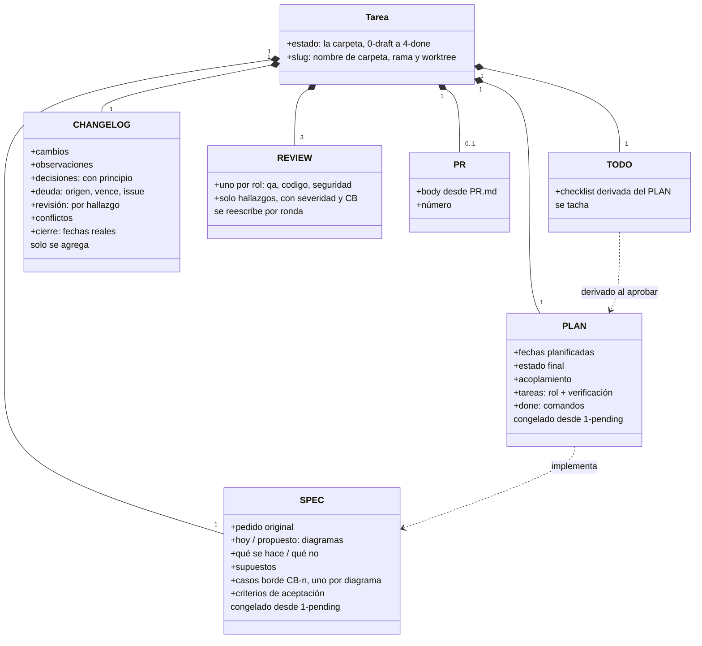
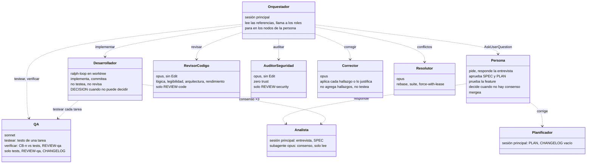

# Roles y artefactos

Cada rol tiene un permiso que le impide hacer el trabajo de otro: QA no toca producción; los revisores no tienen Edit; el corrector no agrega hallazgos; el dev no escribe tests ni reviews; nadie edita SPEC ni PLAN después de aprobados; ningún agente mergea. No es desconfianza: es lo que hace que un fallo quede en un solo lugar y que el changelog diga quién vio qué.

| Rol | Dónde corre | Modelo | Escribe |
|---|---|---|---|
| analista (entrevista) | sesión principal | el de la sesión | `SPEC.md` en `0-draft/` |
| analista (consenso) | subagente | opus | nada |
| planificador | sesión principal | el de la sesión | `PLAN.md`, `CHANGELOG.md` en `0-draft/` |
| desarrollador | sesión principal (ralph-loop) o subagente | opus | código, `TODO.md`, `CHANGELOG.md`; nunca tests, SPEC, PLAN, REVIEW |
| qa | subagente | sonnet | tests, `REVIEW-qa.md`, `CHANGELOG.md` |
| code-reviewer | subagente | opus | `REVIEW-code.md` |
| security-auditor | subagente | opus | `REVIEW-security.md` |
| corrector | subagente | opus | código, `CHANGELOG.md`; nunca tests, SPEC, PLAN, REVIEW |
| conflict-resolver | subagente | opus | lo que esté en conflicto, `CHANGELOG.md` |
