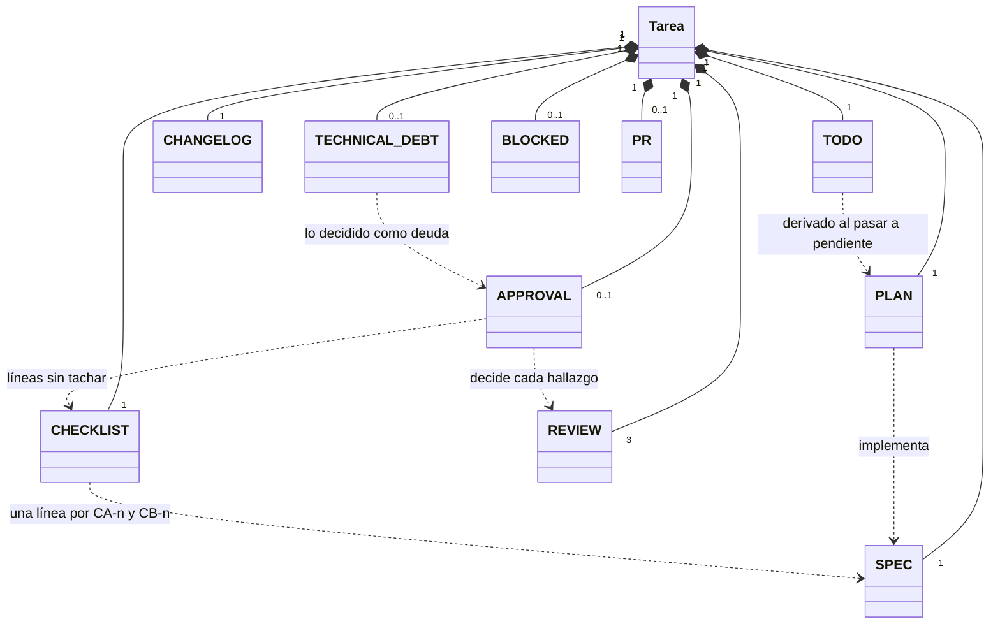
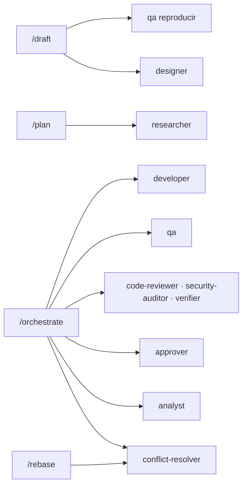

# Roles y artefactos

Fuente única de quién hace, quién no y qué escribe cada rol, y de quién invoca a quién. El resto del plugin enlaza acá; lo garantizan el `hooks:` de cada `agents/*.md` (`write-scope.sh`) y `hooks/plan-immutable.sh`. Qué es cada artefacto y cuándo cambia: `SKILL.md › Qué se congela y qué se escribe`.

## Qué hace, qué no y qué escribe cada rol

| Rol | Dónde corre | Hace | No hace | Escribe |
|---|---|---|---|---|
| **analista** | sesión principal (`/draft`) | entrevista, supuestos, casos borde con diagrama, dudas `D-n` | decidir cómo se implementa | `SPEC.md` en `0-draft/` |
| **analyst** | subagente, ante una `DECISION:` | busca evidencia en historial, código y principios, y elige o dice "sin evidencia" (`consensus.md`) | decidir por gusto, hablar con la persona | nada |
| **designer** | subagente (`/draft`) | propone UX/UI y wireframes `SCR-n` con `mindstack:design` | tocar código, hablar con la persona | `notes/ux.md`, `wireframes/*.wireloom` (renderiza `rendered/`) |
| **planificador** | sesión principal (`/plan`) | acoplamiento, tajadas, tareas con rol y verificación, fechas, Done | implementar, tachar | `PLAN.md`, `TODO.md`, `CHECKLIST.md`, `CHANGELOG.md` vacío |
| **researcher** | subagente (`/plan`) | compara 2 a 4 librerías con datos y recomienda una o "propio" | decidir por recuerdo, instalar | nada |
| **developer** | subagente: una tarea, una corrección o un CI rojo | pone en verde los tests que escribió qa; Cambios, Decisiones; no commitea (lo hace el orquestador) | tests, reviews, refactors grandes, adivinar | código, `TODO.md`, `CHANGELOG.md`, `TECHNICAL_DEBT.md` |
| **qa** | subagente | caja negra: reproduce, escribe los tests de cada tarea antes del código, verifica los `CB-n` en revisión | código de producción, leer el cuerpo de las funciones | tests, `notes/repro.md`, `REVIEW-qa.md`, `CHANGELOG.md` |
| **code-reviewer** | subagente | lógica, legibilidad, arquitectura, rendimiento | editar, elogiar | `REVIEW-code.md` |
| **security-auditor** | subagente | zero trust | editar, bajar severidad por "poco probable" | `REVIEW-security.md` |
| **verifier** | subagente | cada línea de la checklist con evidencia | juzgar calidad, escribir código o tests, cambiar líneas | `CHECKLIST.md` (solo tacha) |
| **approver** | subagente | decide cada hallazgo (`agents/approver.md`) | editar código o tests, agregar hallazgos | `APPROVAL.md`, `TECHNICAL_DEBT.md`, Observaciones del `CHANGELOG.md` |
| **conflict-resolver** | subagente | rebase, suite, `--force-with-lease` | `--force`, "el mío" entero | lo que esté en conflicto, Conflictos del `CHANGELOG.md` |
| **orquestador** | sesión principal (`/orchestrate`) | lee las referencias y llama a los roles en orden; mueve carpetas; filtra propuestas al backlog | lógica propia, mergear, preguntar en el camino, tocar `IDEAS.md` | `BLOCKED.md`, `PR.md`, `backlog/PROPUESTAS.md`; en el CHANGELOG: Cierre, Decisiones (consenso, Retomar), la fila del entorno |

## Quién invoca a quién

Los roles no se llaman entre sí: los invoca la sesión principal, la única que lanza `Agent` y habla con la persona (`CLAUDE.md` del plugin, "Command, agent o skill"). Cada `Agent` sale con `model` y `effort` de `config.sh` (`SKILL.md › Configuración`).

| Quién | A quién | Cuándo | Con qué |
|---|---|---|---|
| `/draft` | `qa reproducir` | la tarea es un fix | síntoma + punto de entrada, sin la causa |
| `/draft` | `designer` | la tarea toca la interfaz | slug, pedido, pantallas que ya existen |
| `/plan` | `researcher`, uno por necesidad | algo que el stack no cubre | la necesidad (`research.md`) |
| implement | `qa testear`, después `developer implementar` | cada tarea del TODO | slug + número |
| implement | `analyst` | el developer devolvió `DECISION:` | pregunta y opciones |
| review | `qa verificar`, `code-reviewer`, `security-auditor`, `verifier` | TODO completo y Done verde | slug, ronda, base (`review.md`) |
| fix | `approver` | después de cada review | slug, ronda n de `rondas_revision` |
| fix | `developer corregir`, después `qa testear correcciones` | `APPROVAL: fix` | slug, ronda |
| pr | `developer ci`, después `qa testear ci` | CI rojo del cambio | slug, id del run |
| conflicts, `/rebase` | `conflict-resolver` | el PR está en conflicto | slug o #pr |

## Skills externas

Todos los agentes tienen la herramienta `Skill`: pueden cargar cualquier skill instalada, de este plugin o de otro. Mindstack no limita el catálogo; lo único cerrado es qué archivos escribe cada rol.
