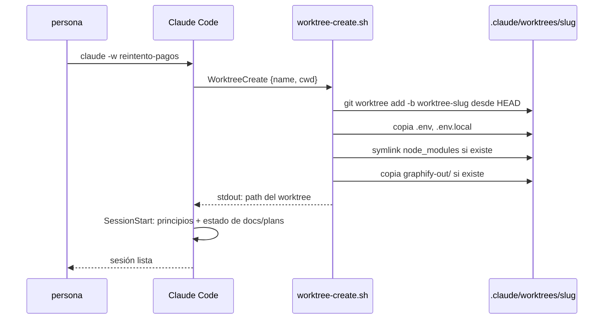

# Cada tarea en su worktree

Claude trabaja en el worktree, no en tu checkout. Dos tareas a la vez son dos worktrees, dos ramas, dos `git status` que no se pisan.

No hay setting que haga que toda sesión arranque en un worktree: se pasa `-w` cada vez (`alias cw='claude -w'`). Lo que sí hay es el hook `WorktreeCreate`, que decide **cómo** se arma:

| Qué | Cómo lo arma el hook | Por qué así |
|---|---|---|
| rama | `worktree-<slug>` desde tu `HEAD` | incluye tus commits sin pushear, que es lo que una tarea nueva suele necesitar |
| `.env` | copia | `.worktreeinclude` no se procesa cuando un hook crea el worktree |
| dependencias instaladas | symlink a las del principal, si hay | mismo lockfile. Si la rama cambia dependencias, un install en el worktree reemplaza el enlace |
| `graphify-out/` | copia, no symlink, si hay | dos sesiones con `--update` sobre un symlink se pisan |

Nada de esto es obligatorio: sin `node_modules` ni `graphify-out/` el hook sigue. El flujo es agnóstico al stack; lo que el stack necesita lo dice su skill.

El `SessionStart` del plugin avisa si abriste `claude` a secas en el checkout principal con tareas en `1-pending/` o `2-in-progress/`: salí y abrí con `-w`.
