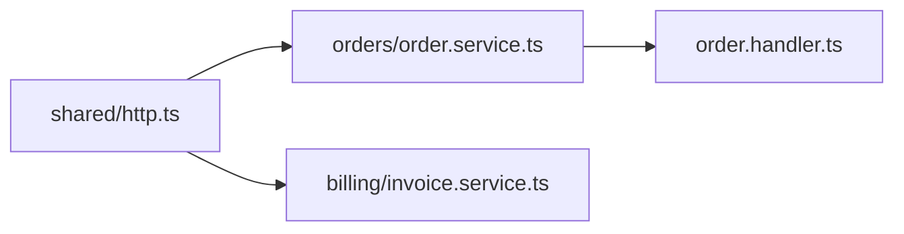
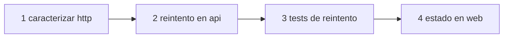

# <mismo título>

<!-- Lo escribe la misma conversación de /mindstack:draft cuando la persona, leído el SPEC, pide el plan. Desde que queda en 1-pending/ no se edita: ni tachar tareas ni corregir fechas. El avance se tacha en TODO.md; lo que pasó, en CHANGELOG.md. Las fechas de acá son las planificadas; las reales van en CHANGELOG.md › Cierre. -->

El estado de esta tarea es la carpeta donde está: `0-draft/` → `1-pending/` → `2-in-progress/` → `3-in-review/` → `4-done/`. Cambiar de estado es `git mv`.

## Objetivo

Un párrafo: qué problema resuelve y para quién. Sale del "Qué se hace" del SPEC. Si no entra en un párrafo, son dos planes.

## Estado final

Lo que tiene que ser cierto cuando esto está hecho. Cada línea verificable por un comando o un test, no por opinión. Incluye los Criterios de aceptación del SPEC y lo que el plan agrega (cobertura, lint, docs).

- [ ] `GET /orders/:id` responde igual que antes (mismo status, mismo body) en los tests de contrato (CB-1)
- [ ] la suite y la cobertura del diff pasan
- [ ] ...

## Fuera de alcance

Lo del SPEC más lo que apareció al leer el código y no entra. Una línea cada uno.

## Acoplamiento

Qué existe hoy que este cambio toca, y qué tan expuesto está. Lo llena `/mindstack:draft` leyendo el repo (con `graphify` si hay grafo, con `grep` si no); se corrige a mano.

| Qué se toca | Quién lo usa (callers, imports) | Tiene test | Riesgo |
|---|---|---|---|
| `orders/order.service.ts` | `order.handler.ts`, `billing/invoice.service.ts` | sí, unit | medio |
| `shared/http.ts` | 14 archivos | no | **alto** |

Si hay más de tres módulos o un caller a dos saltos, el grafo del cambio:



Si es un fix: **Causa raíz**: confirmada / refutada. `archivo:línea`, por qué, qué dice la hipótesis del SPEC si difiere. La tarea 1 es el test de reproducción en rojo (rol: qa) y el Done lo incluye en verde.

Decisión: **tests de caracterización antes de tocar**: sí / no. Si hay una fila con riesgo alto y sin test, es sí, y esos tests son la primera tarea (rol: qa).

## Tareas

Ordenadas por dependencia, en tajadas verticales (un camino completo por tarea, no una capa entera). Cada una chica, con su rol y su verificación. Si una tarea no entra en una iteración del loop, son dos.



1. Caracterizar `shared/http.ts`: tests que fijan el comportamiento actual de los 14 callers. rol: qa. verificación: `npm test -- http` verde.
2. ... rol: developer. verificación: ...
3. Tests de lo nuevo, contra CB-1..CB-n del SPEC. rol: qa. verificación: cada CB tiene al menos un test que lo nombra.
4. ...

## Done

Lo que evalúa el loop para parar. Todo esto, no alguno. Es el comando del stack; el planificador lo saca de la skill del stack o del `CLAUDE.md` del proyecto, y tiene que cubrir lo mismo que corre CI.

```bash
npm run typecheck && npm run lint && npm test && npm run coverage:diff
```

Y todas las casillas de "Estado final" marcadas con evidencia (comando + salida) en `CHANGELOG.md › Cambios`.

## Riesgos y vuelta atrás

| Riesgo | Cómo se detecta | Cómo se deshace |
|---|---|---|
| | | |
