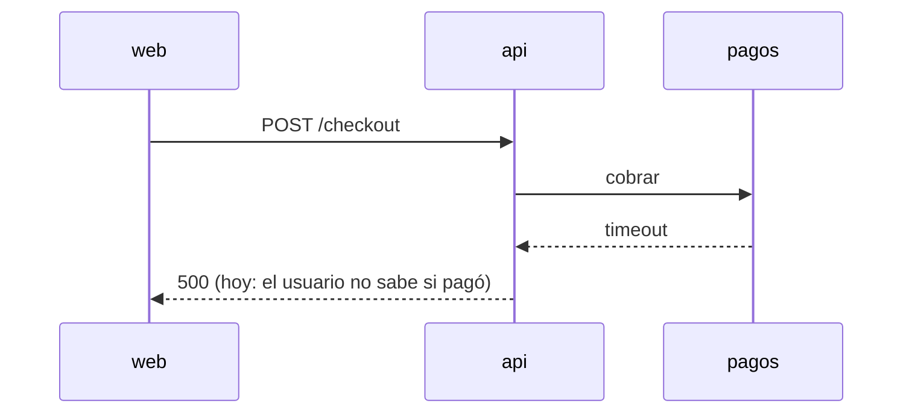
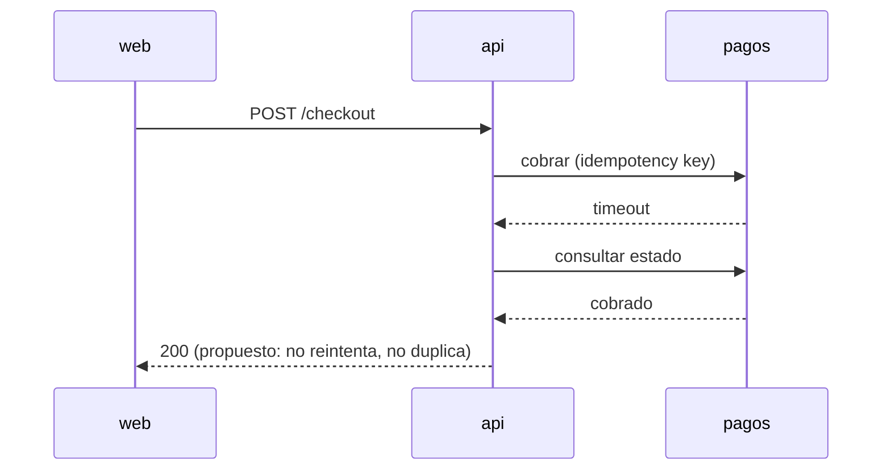
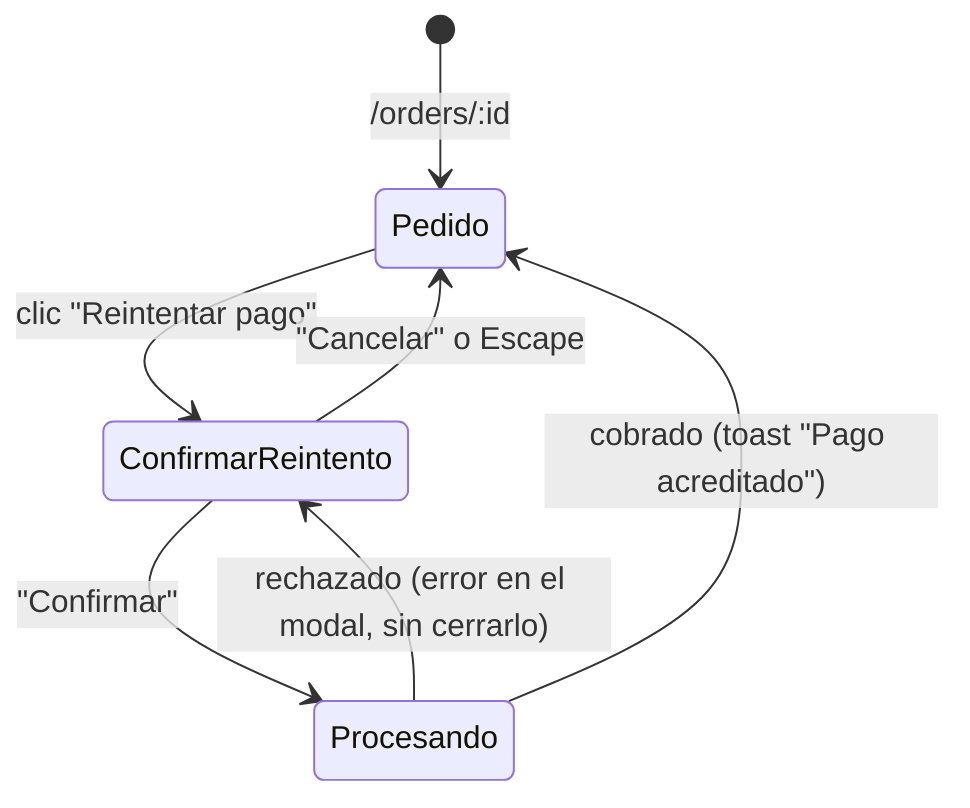
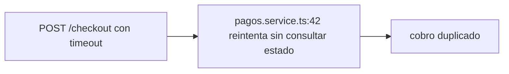
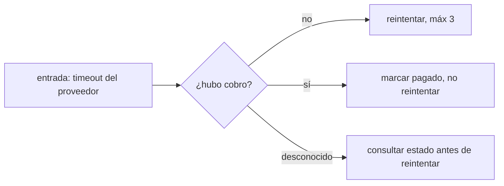

# <mismo título>

<!-- Lo escribe /mindstack:draft en diálogo con la persona, y se corrige con sus comentarios hasta que está de acuerdo y pide el plan. Vive en todolist/0-draft/<slug>/ hasta que el plan lo deja en 1-pending/: desde ahí no se edita (el hook lo bloquea; /mindstack:draft sin texto lo vuelve a borrador). Lo que cambie después va a CHANGELOG.md › Decisiones, o es otra tarea. -->

## Pedido original

Lo que la persona dijo, textual. Dos o tres renglones. Acá no se interpreta: es la evidencia de qué se pidió.

## Cómo funciona hoy

Un diagrama del estado actual entre los actores que el cambio toca. Secuencia si es una interacción; flowchart si es una decisión; stateDiagram si es un ciclo de vida. Uno a tres renglones debajo diciendo qué duele. Un lector que solo mira el diagrama tiene que entender el problema.

## Qué se hace

Un párrafo. Qué cambia y para quién. Si no entra en un párrafo, son dos tareas.

Diagrama propuesto, del mismo tipo que el de arriba, para que se comparen a simple vista.

## UX/UI (solo si toca la interfaz)

Lo que el developer no puede adivinar mirando el código: qué ve la persona, qué dispara cada cosa y qué se queda quieto. Los criterios generales (contraste, modos claro y oscuro, layout estable, accesibilidad) están en la skill `mindstack:design`; acá va lo de esta pantalla. La propuesta inicial la escribe el agente `designer` en `notes/ux.md`; esta sección es esa propuesta corregida con la persona. Sin esta sección, el developer decide el diseño y QA no tiene contra qué comparar.

**Flujo de pantallas**: qué pantalla, modal o panel lleva a cuál, y con qué acción.

**Interacciones**: una fila por cosa que la persona hace o que le pasa.

| Cuando | Se muestra | Cómo | Dónde | Qué no se mueve |
|---|---|---|---|---|
| clic en "Reintentar pago" | confirmación con el monto | AlertDialog | centro | la página de fondo |
| "Confirmar" | spinner en el botón | el botón muestra que está cargando, mismo tamaño | pie del AlertDialog | título y botones del AlertDialog |
| el cobro falla | mensaje del proveedor | texto en el renglón reservado bajo el título | dentro del AlertDialog | botones del AlertDialog |
| el cobro pasa | "Pago acreditado" | toast, 5 s | abajo a la derecha | contenido de la página |

**Estados de cada pantalla**: qué se ve en cada uno; si alguno no aplica, se dice.

| Pantalla | Cargando | Vacío | Error | Sin permiso | Con datos |
|---|---|---|---|---|---|
| Pedido | skeleton con las medidas del detalle | — | mensaje + "Reintentar" | 403: "No tenés acceso a este pedido" | detalle + botón |

**Componentes y medidas**: modales y paneles con su tamaño (chico, mediano, grande), qué parte scrollea y qué queda fijo; qué contenido aparece o cambia y cómo reserva su lugar.

**Textos**: títulos, botones, mensajes de error y de éxito, textuales. Lo que la persona va a leer no lo inventa el developer.

**Responsive y accesibilidad propios de esta pantalla**: qué cambia en mobile, orden de foco, a dónde va el foco al abrir y cerrar, atajos. Si no hay nada fuera de lo de `mindstack:design`, se dice "lo de `mindstack:design`".

## Qué no se hace

Lo que alguien va a querer meter y no entra. Una línea cada uno, con el motivo si no es obvio.

- ...

## Supuestos

Lo que se asume y no se verificó. Si uno resulta falso durante la implementación, va a Decisiones del CHANGELOG; si invalida el alcance, es otra tarea.

- ASUMO que ...

## Diagnóstico (solo si es un fix)

Si la tarea arregla algo, antes de los casos borde va esto. Sin reproducción no se aprueba la tarea.

- **Síntoma**: qué se ve, dónde, desde cuándo. Textual, con el error exacto si lo hay.
- **Reproducción** (la escribe `qa` por encargo del analista, en caja negra, sin conocer la causa probable; ver `notes/repro.md`): nivel `unit` / `integration` / `e2e` / `manual`. La entrada mínima, el test o los pasos, y la salida observada frente a la esperada.
- **Causa probable**: `archivo:línea`, por qué, confianza en %. Es hipótesis del analista; la confirma o refuta el planificador en `PLAN.md › Acoplamiento`.
- **Descartado**: qué se miró y no es.

## Casos borde

Uno por sección, numerados `CB-n`. El id es estable: QA lo busca en los tests y lo cita en `REVIEW-qa.md`. Cada uno con su diagrama: es lo que QA va a reproducir sin preguntarle al analista.

### CB-1: <qué pasa cuando ...>

Entrada o situación. Qué tiene que pasar. Qué no tiene que pasar.

### CB-2: <...>

## Criterios de aceptación

Lo que tiene que ser cierto cuando está hecho. Cada línea verificable por un comando o un test, no por opinión. Entre paréntesis, los CB que cubre.

- [ ] ... (CB-1, CB-3)
- [ ] ...

## Preguntas abiertas

Lo que no se pudo cerrar en la entrevista. Si queda alguna al pedir el plan, el plan la hereda como riesgo.
