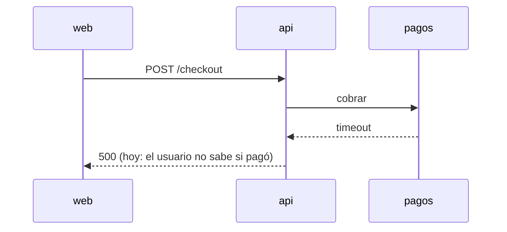
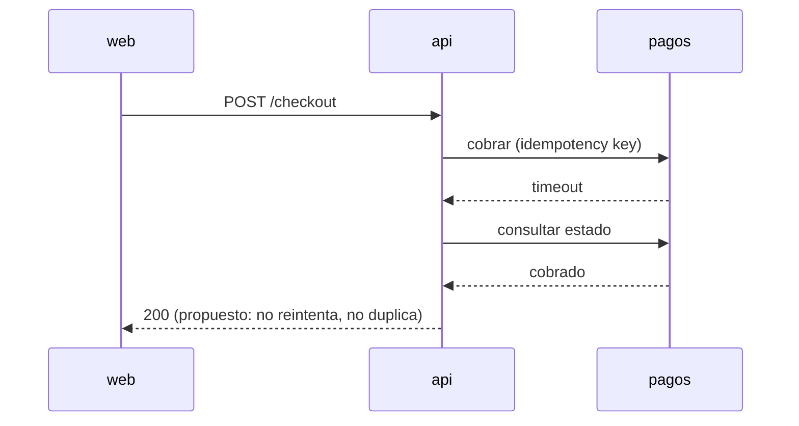
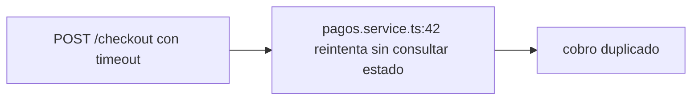
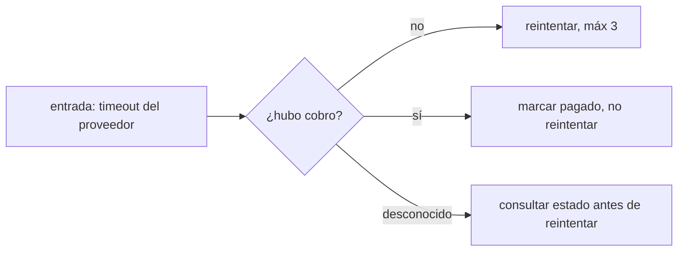

# <mismo título>

<!-- Lo escribe /mindstack:draft en diálogo con la persona, y se corrige con sus comentarios hasta que está de acuerdo y pide el plan. Vive en docs/plans/0-draft/<slug>/ hasta que /mindstack:approve lo congela: desde ahí no se edita (el hook lo bloquea). Lo que cambie después va a CHANGELOG.md › Decisiones, o es otra tarea. -->

## Pedido original

Lo que la persona dijo, textual. Dos o tres renglones. Acá no se interpreta: es la evidencia de qué se pidió.

## Cómo funciona hoy

Un diagrama del estado actual entre los actores que el cambio toca. Secuencia si es una interacción; flowchart si es una decisión; stateDiagram si es un ciclo de vida. Uno a tres renglones debajo diciendo qué duele. Un lector que solo mira el diagrama tiene que entender el problema.

## Qué se hace

Un párrafo. Qué cambia y para quién. Si no entra en un párrafo, son dos tareas.

Diagrama propuesto, del mismo tipo que el de arriba, para que se comparen a simple vista.

## Qué no se hace

Lo que alguien va a querer meter y no entra. Una línea cada uno, con el motivo si no es obvio.

- ...

## Supuestos

Lo que se asume y no se verificó. Si uno resulta falso durante la implementación, va a Decisiones del CHANGELOG; si invalida el alcance, es otra tarea.

- ASUMO que ...

## Diagnóstico (solo si es un fix)

Si la tarea arregla algo, antes de los casos borde va esto. Sin reproducción no se aprueba la tarea.

- **Síntoma**: qué se ve, dónde, desde cuándo. Textual, con el error exacto si lo hay.
- **Reproducción** (la escribe `qa` por encargo del analista, en caja negra, sin conocer la causa probable; ver `notes/repro.md`): nivel `unit` / `integration` / `e2e` / `manual`. La entrada mínima, el test o los pasos, y la salida observada frente a la esperada.
- **Causa probable**: `archivo:línea`, por qué, confianza en %. Es hipótesis del analista; la confirma o refuta el planificador en `PLAN.md › Acoplamiento`.
- **Descartado**: qué se miró y no es.

## Casos borde

Uno por sección, numerados `CB-n`. El id es estable: QA lo busca en los tests y lo cita en `REVIEW-qa.md`. Cada uno con su diagrama: es lo que QA va a reproducir sin preguntarle al analista.

### CB-1: <qué pasa cuando ...>

Entrada o situación. Qué tiene que pasar. Qué no tiene que pasar.

### CB-2: <...>

## Criterios de aceptación

Lo que tiene que ser cierto cuando está hecho. Cada línea verificable por un comando o un test, no por opinión. Entre paréntesis, los CB que cubre.

- [ ] ... (CB-1, CB-3)
- [ ] ...

## Preguntas abiertas

Lo que no se pudo cerrar en la entrevista. Si queda alguna al aprobar, el plan la hereda como riesgo.
