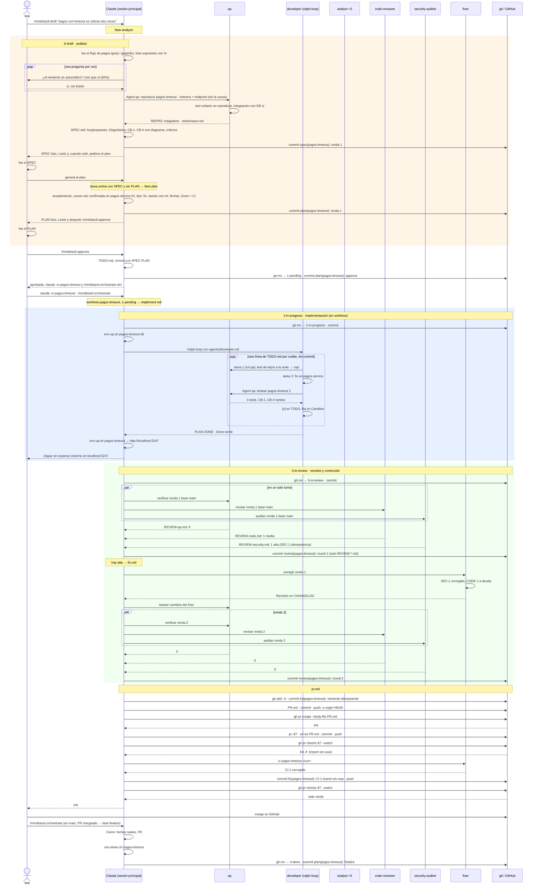

# 01 · Un bug, de punta a punta, autónomo

Pedís que se arregle algo con `/draft`, leés el SPEC, decís "generá el plan", lo leés, aprobás, y no intervenís hasta que hay un PR con CI verde. Tres comandos tuyos, una frase, y el merge.



## Dónde para y por qué

| Parada | Por qué no se puede saltear |
|---|---|
| aprobar (`/approve`, tuyo) | es el contrato. Lo que no está en SPEC/PLAN no se hace; lo que está, se congela. El orquestador no arranca sin eso |
| consenso sin acuerdo (caso 03) | tres analistas no coincidieron: la decisión es tuya |
| ronda 2 con crítica o alta | dos rondas que no cierran son un desacuerdo, no un bug |
| `BLOCKED:` o tres fallos en la misma tarea | algo externo o una ambigüedad que el consenso no resolvió |
| CI rojo tres veces, o rojo por algo ajeno al cambio | el orquestador itera con el log hasta tres rondas; más es el entorno, no el código |
| merge | ningún agente mergea |

"Probar" no es parada: la URL queda impresa y en `CHANGELOG › Cambios`; probás cuando querés.

## Qué quedó en la carpeta

```
docs/plans/4-done/pagos-timeout/
├── SPEC.md          Diagnóstico con REPRO: integration, CB-1..CB-4
├── PLAN.md          tipo: fix · causa raíz confirmada · tareas 1 (qa) y 2 (dev)
├── TODO.md          [x] [x]
├── CHANGELOG.md     Cambios, Decisiones, Deuda (#45), Revisión (2 rondas), Cierre
├── REVIEW-qa.md     ronda 2, vacío
├── REVIEW-code.md   ronda 2, vacío
├── REVIEW-security.md ronda 2, vacío
├── PR.md            pr: 87
└── notes/repro.md
```
