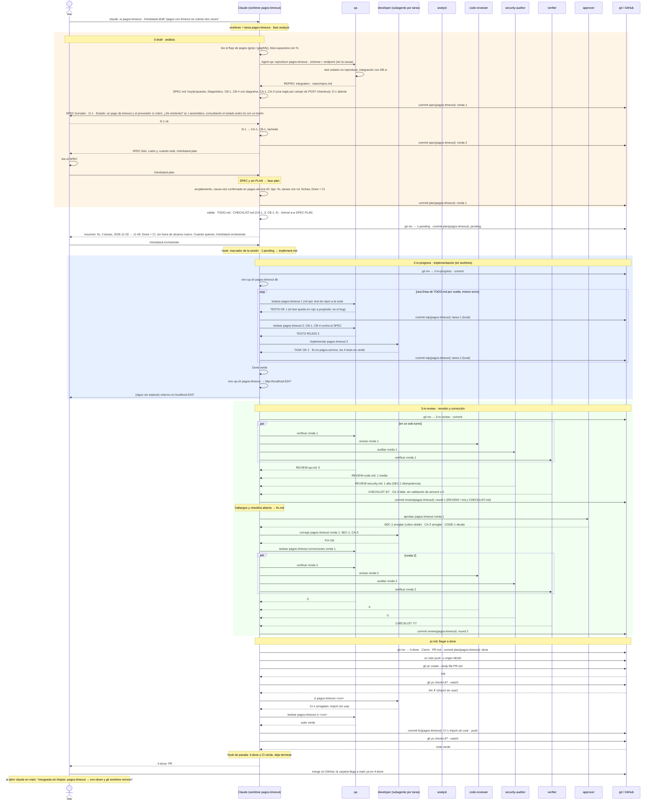

# 01 · Un bug, de punta a punta, autónomo

Abrís el worktree, pedís que se arregle algo con `/draft`, leés el SPEC, `/plan`, `/orchestrate`, y no intervenís hasta que la tarea está en `4-done`: todo commiteado, PR abierto y CI verde, lista para mergear. Todo en el mismo worktree.



## Dónde para y por qué

| Parada | Por qué no se puede saltear |
|---|---|
| pedir el plan (`/plan` o "generá el plan", tuyo) | es el contrato. Lo que no está en el SPEC no se hace; con el plan hecho, los dos se congelan. El orquestador no arranca sin eso |
| `blocked/` (motivos: `orchestrate.md › Bloquear`) | necesita una decisión tuya. Lo dice `BLOCKED.md`, lo muestra el aviso al abrir `claude`, y el PR vuelve a draft |
| `4-done` | lista para mergear: probás y mergeás, o `/draft` lo que falta |
| merge | ningún agente mergea |

"Probar" no es parada: la URL queda impresa y en `CHANGELOG › Cambios`; probás cuando querés.

## Qué quedó en la carpeta

```
todolist/4-done/pagos-timeout/
├── SPEC.md          Diagnóstico con REPRO: integration, CB-1..CB-4
├── PLAN.md          tipo: fix · causa raíz confirmada · tareas 1 (qa) y 2 (dev)
├── TODO.md          [x] [x]
├── CHECKLIST.md     CA-1..3, CB-1..4, todas tachadas con evidencia
├── CHANGELOG.md     Cambios, Decisiones, CI-1, Cierre
├── APPROVAL.md      2 rondas de decisiones del approver
├── TECHNICAL_DEBT.md CODE-1 (#45)
├── REVIEW-qa.md     ronda 2, vacío
├── REVIEW-code.md   ronda 2, vacío
├── REVIEW-security.md ronda 2, vacío
├── PR.md            body del PR #87
└── notes/repro.md
```
