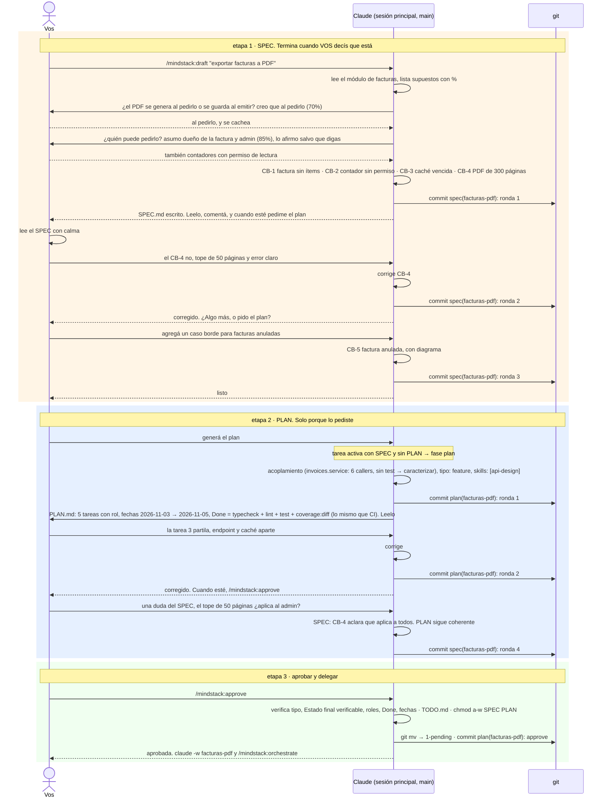

# 02 · Lo que vos hacés: borrador y aprobación

Tu participación antes de delegar: `/draft` con lo que querés, comentarios sueltos, "generá el plan", más comentarios, `/approve`. Entre cada paso hay tantas vueltas como quieras, y cada vuelta que cambia un archivo es un commit. Nada avanza de etapa sin que lo pidas: el analista no genera el plan, el planificador no aprueba.

Si es un bug, en la etapa 1 el analista lanza a `qa` para reproducirlo antes de escribir el SPEC (caso 01): sin reproducción no hay tarea.

## Las tres etapas, y qué las dispara

| Etapa | La dispara | Termina | Commits |
|---|---|---|---|
| SPEC | `/mindstack:draft "<qué querés>"` | cuando vos decís que está. El analista no sigue solo | `spec(<slug>): ronda n`, uno por vuelta que cambie el archivo |
| PLAN | decís "generá el plan" en la conversación | cuando vos decís que está | `plan(<slug>): ronda n` |
| aprobar | `/mindstack:approve` | mueve a `1-pending/` y congela | `plan(<slug>): approve` |

Mientras la tarea está en `0-draft/` podés volver a cualquiera de los dos archivos con un comentario: la conversación sabe cuál es la tarea. Si cambiás el SPEC después del PLAN, el planificador revisa que el plan siga coherente y lo dice.

## Qué podés decir en el medio

Cualquier cosa. "No, el tope es 100", "agregá un caso borde para facturas anuladas", "el Done tiene que correr los tests e2e", "mostrame el diagrama de hoy otra vez". Después de `/approve` no se toca más, y lo que falte es una iteración (`generá el plan "qué falta"`, caso 06).

## Lo que no hacés

Ni implementás, ni testeás, ni revisás, ni abrís el PR. Eso es del orquestador (caso 01). Volvés a aparecer para probar en `localhost`, para desempatar si tres analistas no coinciden, y para mergear.
