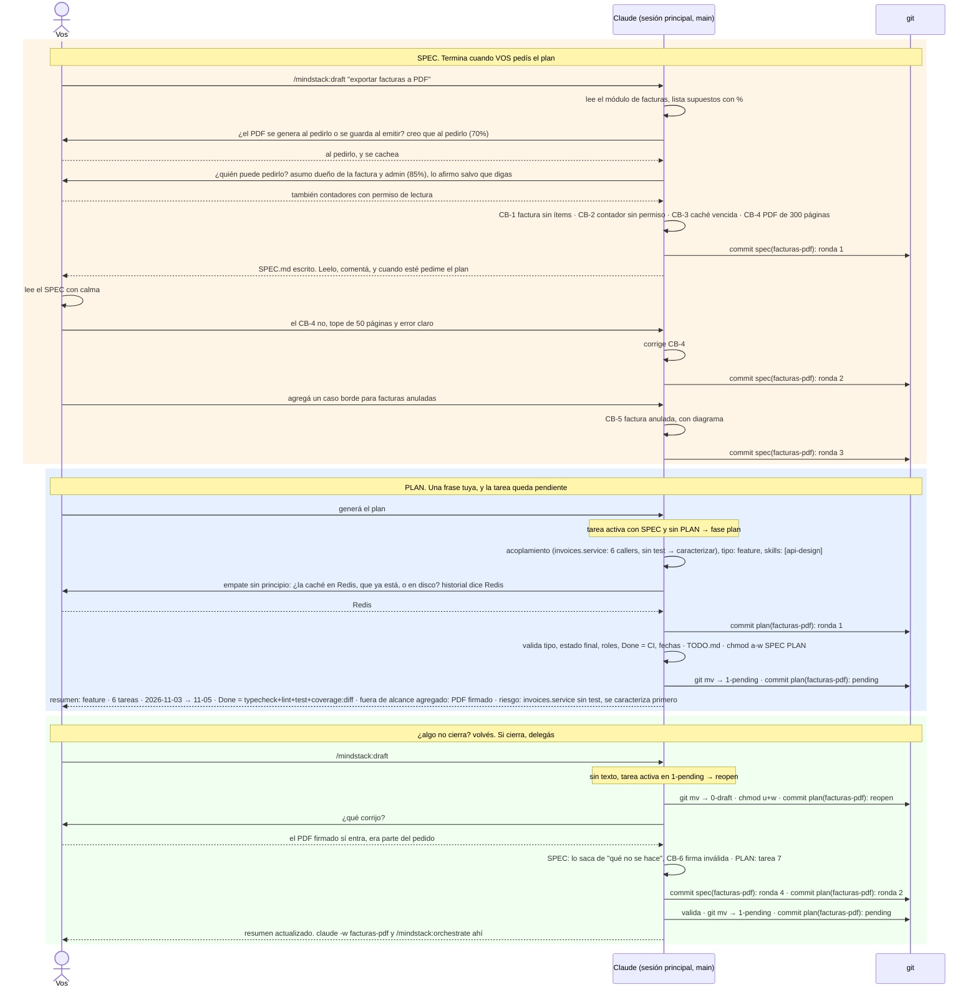

# 02 · Lo que vos hacés: el borrador

Tu participación antes de delegar es una sola conversación: `/draft` con lo que querés, comentarios sueltos hasta que el SPEC dice lo que querés, y "generá el plan". Con eso la tarea queda pendiente. Cada vuelta que cambia un archivo es un commit. El plan no se aprueba: es la checklist del orquestador; vos leés un resumen de cinco líneas y, si algo no cierra, `/draft` sin texto la devuelve a borrador.

Si es un bug, antes de escribir el SPEC el analista lanza a `qa` para reproducirlo (caso 01): sin reproducción no hay plan.

## Las etapas, y qué las dispara

| Etapa | La dispara | Termina | Commits |
|---|---|---|---|
| SPEC | `/mindstack:draft "<qué querés>"` | cuando vos pedís el plan. El analista no sigue solo | `spec(<slug>): ronda n`, uno por vuelta que cambie el archivo |
| PLAN | "generá el plan" en la conversación | en el mismo turno: valida, deriva `TODO.md`, congela, mueve a `1-pending/`, resumen | `plan(<slug>): ronda n` y `plan(<slug>): pending` |
| volver | `/mindstack:draft` sin texto | cuando pedís el plan otra vez | `plan(<slug>): reopen`, y de nuevo los de arriba |

El planificador te pregunta solo lo que un principio no decide (un empate real, una pregunta abierta del SPEC que cambie el plan). No pregunta "¿está bien el plan?".

## Qué podés decir en el medio

Cualquier cosa. "No, el tope es 100", "agregá un caso borde para facturas anuladas", "el Done tiene que correr los tests e2e", "mostrame el diagrama de hoy otra vez". Mientras la tarea está en borrador, la conversación sabe cuál es. Cuando ya está pendiente, `/draft` sin texto la trae de vuelta; mientras no abriste el worktree, no corrió nada.

## Lo que no hacés

Ni implementás, ni testeás, ni revisás, ni abrís el PR. Eso es del orquestador (caso 01). Volvés a aparecer para probar en `localhost`, para desempatar si tres analistas no coinciden, y para mergear.
