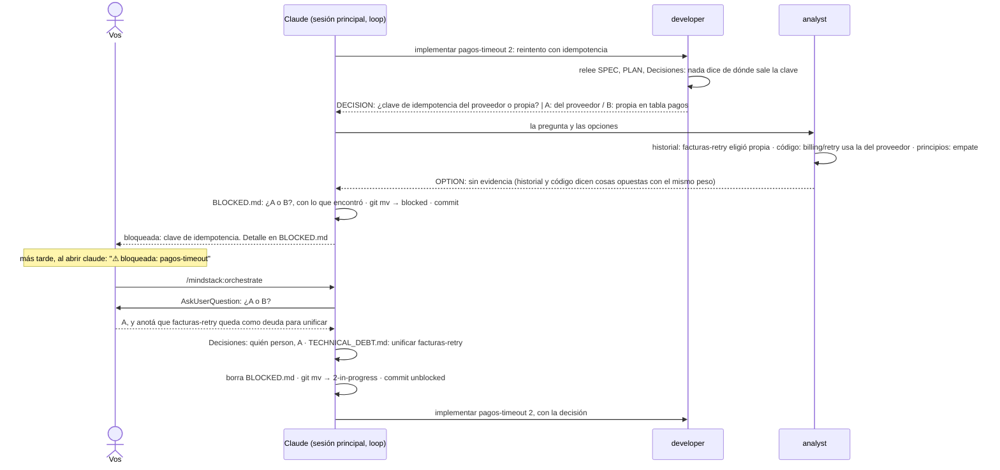

# 03 · El dev no puede decidir

Durante la implementación el `developer` encuentra algo que ni el SPEC, ni el PLAN, ni un principio resuelven. No adivina y no te interrumpe de entrada: un analista busca la respuesta en lo que ya existe. Si la evidencia alcanza, decide; si no, la tarea va a `blocked/` con la pregunta y te enterás al abrir `claude`.

Cuando la evidencia alcanza (`OPTION: A`), el orquestador anota la decisión con quién `analyst` y sigue: no te enterás hasta que leés el CHANGELOG, y eso es lo que querés. Las reglas: `skills/workflow/references/consensus.md`.
