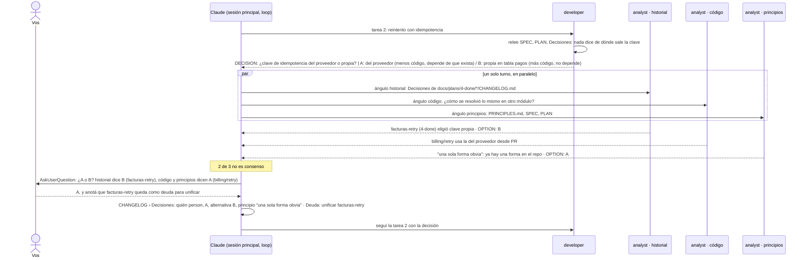

# 03 · El dev no puede decidir

Durante la implementación el `developer` encuentra algo que ni el SPEC, ni el PLAN, ni un principio resuelven. No adivina y no te interrumpe de entrada: tres analistas buscan la respuesta en lo que ya existe. Si coinciden, se decide; si no, recién ahí vos.

## Cuando sí hay consenso

Los tres devuelven la misma `OPTION`: el dev escribe la fila en Decisiones con quién `consensus`, una línea por ángulo con su evidencia, y sigue. No te enterás hasta que leés el CHANGELOG, y eso es lo que querés: la pregunta ya tenía respuesta en el repo.

## Por qué tres y no uno

Uno confirma lo que el dev ya pensó. Tres con ángulos distintos (lo que se decidió antes, lo que el código ya hace, lo que los principios dicen) solo coinciden cuando la respuesta es obvia, y el desacuerdo es la señal exacta de que hace falta una persona.

## Sin persona disponible

En CI (`$CI` definido) no hay a quién preguntar: el dev termina con `BLOCKED: consenso sin acuerdo sobre …`, el loop para y la tarea queda en `2-in-progress/` con la pregunta en el CHANGELOG. Retomás con `/mindstack:orchestrate` después de responderla.
