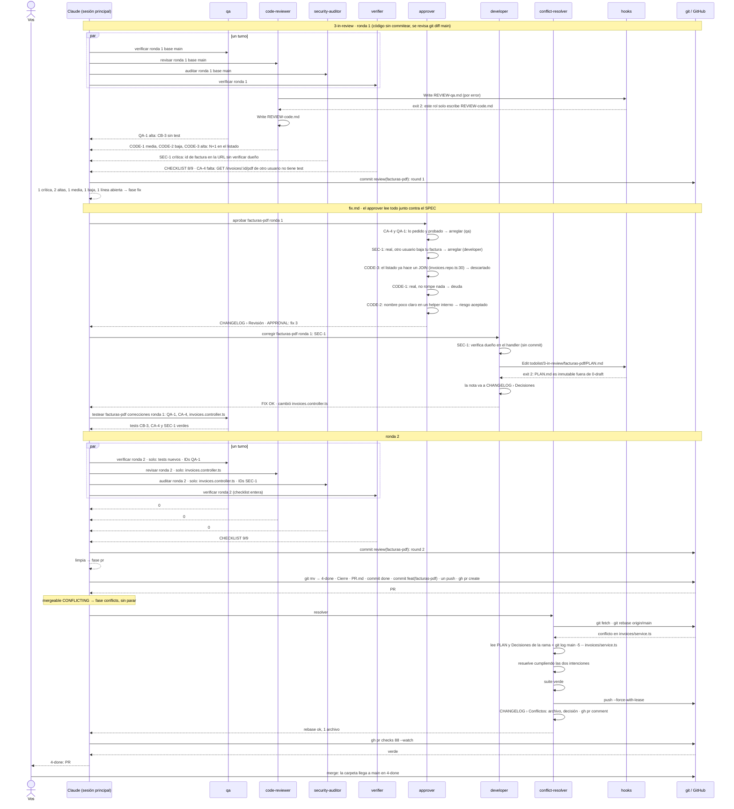

# 04 · Revisión con hallazgos, corrección y conflicto con main

Lo que pasa cuando la revisión encuentra algo, cuando un hallazgo está mal o pide lo que el SPEC no pide, cuando falta algo de la checklist, cuando el PR choca con otro que entró antes, y cómo llega a `4-done`.

## Qué garantiza cada red

| Red | Qué paró en este caso |
|---|---|
| `write-scope.sh` del `code-reviewer` | que escribiera el archivo de QA |
| `plan-immutable.sh` | que el `developer` tocara el PLAN |
| `approver` mirando todo junto | CODE-3 estaba mal: nadie tocó un listado que andaba. CODE-1 y CODE-2 no frenaron la tarea: quedaron como deuda y riesgo aceptado, con motivo, y los ves en el PR |
| `verifier` y `CHECKLIST.md` | CA-4 (otro usuario no ve tu PDF) no tenía test aunque el código lo cubría; ahora lo tiene. Eso no se negocia |
| ronda 2 sobre lo que cambió | los revisores no encontraron cosas nuevas en código que ya había pasado |
| tope `rondas_revision` (8) | en la última, el approver cierra lo suyo como deuda o riesgo; solo una línea de checklist, un `QA-n`, un secreto o una pérdida irreversible abiertos van a `blocked/` |
| rebase y `--force-with-lease`, nunca `--force` | el resolutor no pisó lo que otro pusheó |
| nadie mergea | el merge fue tuyo |
