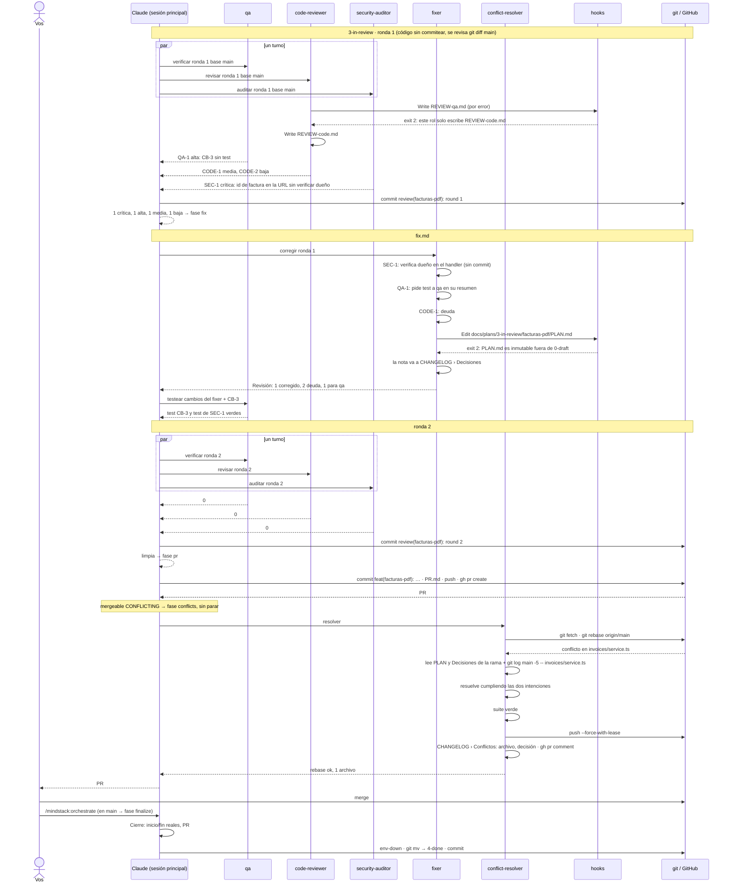

# 04 · Revisión con hallazgos, corrección y conflicto con main

Lo que pasa cuando la revisión encuentra algo, cuando el PR choca con otro que entró antes, y cómo se cierra.

## Qué garantiza cada red

| Red | Qué paró en este caso |
|---|---|
| `write-scope.sh` del `code-reviewer` | que escribiera el archivo de QA |
| `plan-immutable.sh` | que el `fixer` tocara el PLAN |
| crítica y alta no pueden ser deuda | SEC-1 se corrigió; QA-1 se testeó |
| tope de dos rondas | si la ronda 2 hubiera traído otra crítica, parada para vos |
| rebase y `--force-with-lease`, nunca `--force` | el resolutor no pisó lo que otro pusheó |
| nadie mergea | el merge fue tuyo |
