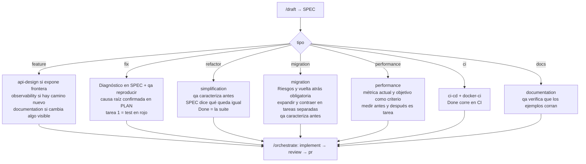

# 05 · Variantes por tipo de tarea

El flujo es el mismo; lo que cambia es qué carga el `developer`, qué exige el PLAN y qué hace `qa` primero. Lo decide `tipo:` en el frontmatter del PLAN (tabla completa en `skills/workflow/references/plan.md`).

## Ejemplos de pedido y qué pasa

| Vos decís | `tipo` | Lo distinto |
|---|---|---|
| "los pagos con timeout se cobran dos veces" | `fix` | antes de pedir el plan, `qa` reproduce (caso 01). Sin reproducción no hay tarea |
| "exportar facturas a PDF" | `feature` | el planificador carga `api-design` porque expone un endpoint; el contrato queda en el PLAN |
| "el módulo de órdenes es ilegible, ordenalo" | `refactor` | el SPEC dice qué comportamiento queda igual; `qa` fija ese comportamiento con tests antes de que el dev toque nada; `simplification` guía al dev |
| "pasar de sesiones en memoria a JWT" | `migration` | PLAN con vuelta atrás obligatoria; tarea "expandir" (los dos coexisten) y tarea "contraer" (se saca lo viejo) separadas; `auth-jwt-sessions` como pre-plan si aplica |
| "el listado tarda 4 segundos" | `performance` | el SPEC trae la medición actual y la objetivo como criterio de aceptación; sin medir no hay hallazgo ni Done |
| "que el CI corra cobertura del diff" | `ci` | el Done se prueba en el pipeline, no solo local |
| "documentá cómo se levanta el proyecto" | `docs` | sin código; `qa` corre los comandos del README |

## Mezclas

Una feature que necesita migrar una tabla: `tipo: migration` (el más riesgoso manda) y `skills: [mindstack:migration, mindstack:api-design]`. El planificador lo decide y lo deja en Decisiones con el principio.

## Lo que no cambia

Siempre: SPEC con casos borde y diagrama, PLAN congelado al quedar pendiente, TODO como avance, CHANGELOG como memoria, código sin commitear hasta que tres revisores dijeron que está, PR abierto por el flujo, merge tuyo.
