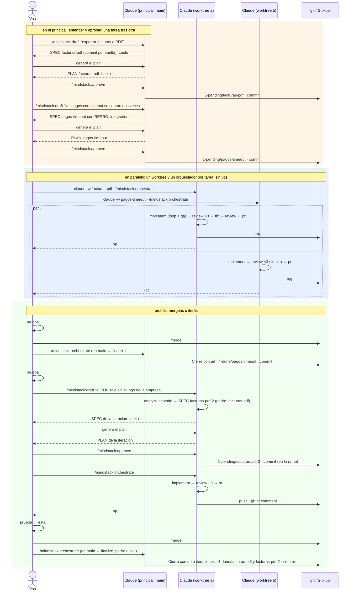

# 06 · Varias tareas en paralelo e iteración sobre un PR

El modelo de uso diario: lo que necesita hablar con vos pasa en el checkout principal; lo que no, corre en paralelo en worktrees. Al final probás cada PR, y mergeás o iterás.



## Por qué una tarea hija y no "arreglalo"

| Si fuera "arreglalo en la sesión" | Con tarea hija |
|---|---|
| el cambio no tiene SPEC: nadie sabe qué se pidió | `SPEC.md` propio, acotado a lo que falta, con `padre:` |
| el PLAN del padre dice una cosa y el código otra | el PLAN del padre sigue intacto y verdadero; la hija tiene el suyo |
| sin revisión: lo que entra al PR después de la revisión nadie lo miró | pasa por los tres revisores igual |
| el CHANGELOG mezcla dos pedidos | cada una con su memoria; el Cierre del padre lista las iteraciones |

## Qué queda cuando termina

```
docs/plans/4-done/
├── facturas-pdf/      SPEC, PLAN, TODO, CHANGELOG (Cierre: PR #88, url, iteración facturas-pdf-2), REVIEW-*, PR.md (pr: 88, url)
├── facturas-pdf-2/    SPEC (padre: facturas-pdf), PLAN, TODO, CHANGELOG, REVIEW-*, PR.md (pr: 88, url)
└── pagos-timeout/     …, PR.md (pr: 89, url)
```

Los links abren los PRs mientras GitHub exista; si un día no, la carpeta tiene todo lo que importa: qué se pidió, qué se decidió, qué dijeron los revisores, qué quedó como deuda. Un PR cerrado sin merge también se finaliza: `fase finalize` trae la carpeta desde la rama antes de que se borre.
