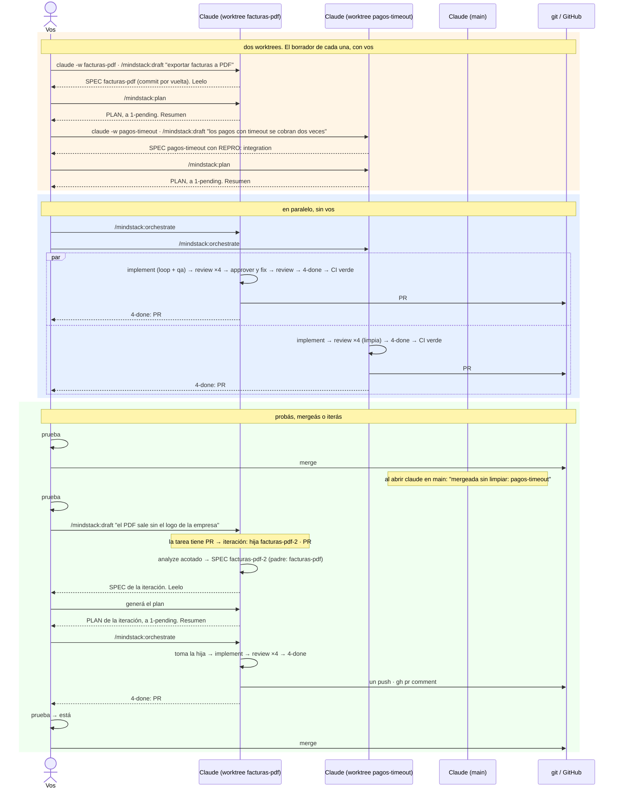

# 06 · Varias tareas en paralelo e iteración sobre un PR

El modelo de uso diario: un worktree por tarea, cada uno con su sesión. El borrador lo hacés de a uno (necesita hablar con vos); los orquestadores corren en paralelo. Cada tarea termina en `4-done` (PR verde, lista para mergear) o en `blocked/`. Probás cada PR, y mergeás o iterás.



## Por qué una tarea hija y no "arreglalo"

| Si fuera "arreglalo en la sesión" | Con tarea hija |
|---|---|
| el cambio no tiene SPEC: nadie sabe qué se pidió | `SPEC.md` propio, acotado a lo que falta, con `padre:` |
| el PLAN del padre dice una cosa y el código otra | el PLAN del padre sigue intacto y verdadero; la hija tiene el suyo |
| sin revisión: lo que entra al PR después de la revisión nadie lo miró | pasa por los cuatro revisores igual |
| el CHANGELOG mezcla dos pedidos | cada una con su memoria; el Cierre del padre lista las iteraciones |

## Qué queda cuando termina

```
todolist/4-done/
├── facturas-pdf/      SPEC, PLAN, TODO, CHECKLIST, CHANGELOG (Cierre, iteración facturas-pdf-2), REVIEW-*, PR.md
├── facturas-pdf-2/    SPEC (padre: facturas-pdf), PLAN, TODO, CHECKLIST, CHANGELOG, REVIEW-*, PR.md
└── pagos-timeout/     …
```

El PR de cada tarea se encuentra desde la rama o en el historial de GitHub; la carpeta tiene todo lo que importa: qué se pidió, qué se decidió, qué dijeron los revisores, qué quedó como deuda. Un PR cerrado sin merge deja la carpeta solo en su rama.
