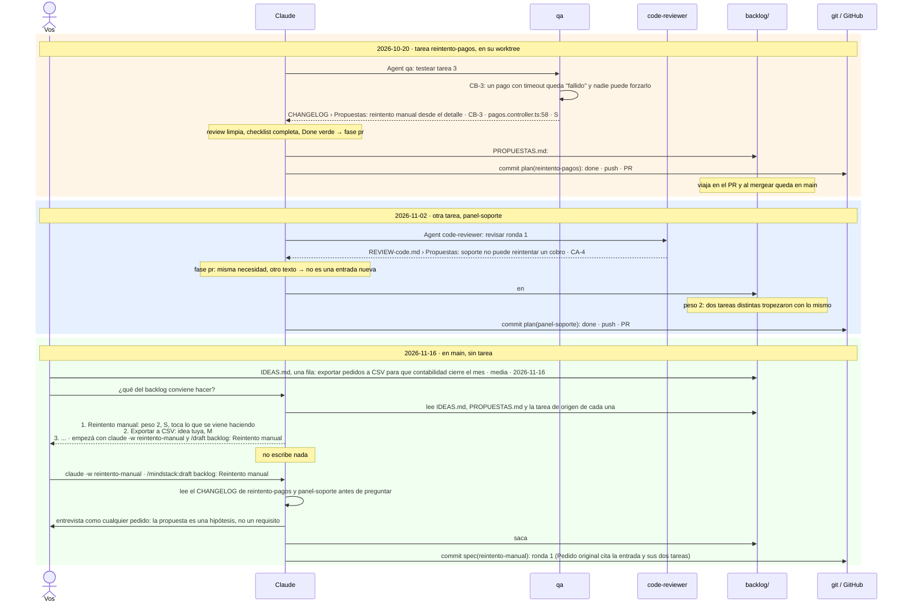

# 07 · El backlog: lo que proponés vos y lo que proponen los agentes

`todolist/backlog/` no es un estado: son dos listas de cosas que todavía nadie pidió. `IDEAS.md` es tuyo y ningún agente lo toca. `PROPUESTAS.md` lo arma el orquestador con lo que los agentes vieron mientras trabajaban; una propuesta gana peso cada vez que otra tarea tropieza con lo mismo. Ninguna de las dos se convierte en tarea sola: la elegís vos.

## Quién escribe qué

| Archivo | Quién | Cuándo |
|---|---|---|
| `CHANGELOG › Propuestas` | developer, qa, approver | mientras trabajan, con la fecha en que lo vieron y dónde (`CA-n`, `CB-n`, `archivo:línea`) |
| `REVIEW-*.md › Propuestas` | code-reviewer, security-auditor | al revisar; no cuenta como hallazgo |
| `backlog/PROPUESTAS.md` | el orquestador | en la fase pr, con la tarea terminada y antes del push: filtra (sin "dónde se vio" no entra), deduplica (`Visto también`), máximo tres nuevas por tarea |
| `backlog/IDEAS.md` | vos | cuando quieras. Un agente que lo intente lo frena el hook |

## Cómo se ordena cuando preguntás

Primero el peso: cuántas tareas distintas vieron la misma necesidad. Después qué tan cerca está de lo último que se hizo, el tamaño y la antigüedad. Tus ideas pesan más que una propuesta vista una sola vez, y menos que una que se repite en muchas tareas.

## Lo que no pasa

- Un agente no implementa lo que propone: si lo hiciera, sería alcance que nadie pidió.
- Una tarea que termina en `blocked/` no pasa sus propuestas: quedan en su CHANGELOG hasta que llega a `4-done`.
- Una propuesta no se borra sola. Si no te sirve, la borrás vos.
