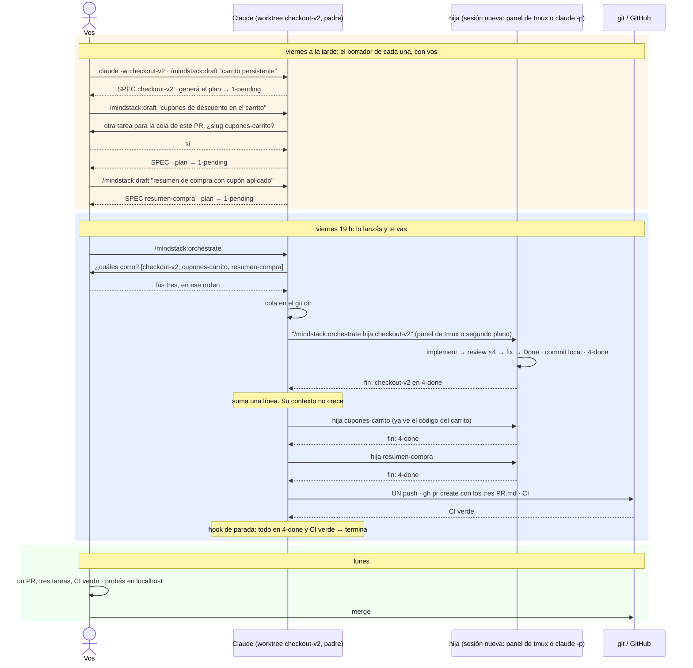
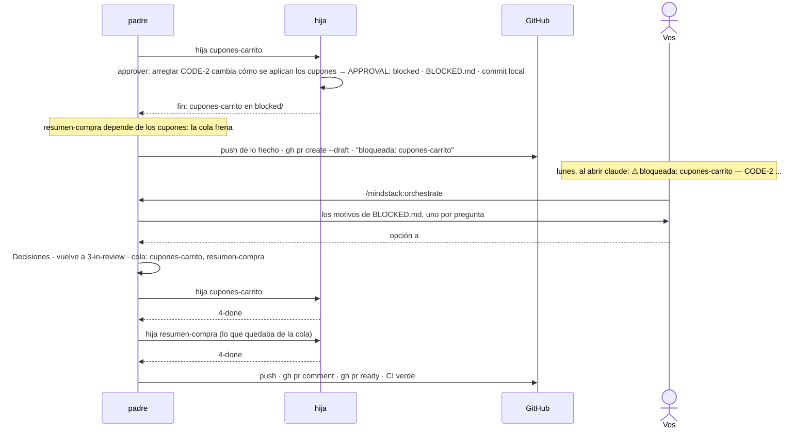

# 08 · Una cola de tareas para el fin de semana, en un solo PR

Varias tareas que dependen entre sí, o que te da igual cuánto tarden: las escribís todas en el mismo worktree y `/orchestrate` las corre en orden, cada una en una sesión nueva, sin que vos mires. Todas viajan en un PR. Es lento y funciona. Si querés rapidez y sabés que no dependen, es el caso 06: un worktree por tarea, en paralelo.

## Si una se bloquea a mitad

## Qué cambia respecto de una tarea sola

| | Una tarea | Cola |
|---|---|---|
| Worktree, rama, PR | uno | uno, para todas |
| Quién implementa | el orquestador de tu sesión | una sesión nueva por tarea (panel de tmux al lado del padre si corre en tmux; si no, `claude -p`), en el mismo worktree |
| Push | uno, en la fase pr | uno, al final de la cola (las hijas commitean local) |
| CI | una vez | una vez, sobre todo |
| Se bloquea | `blocked/`, PR a draft si había | la cola frena, lo hecho sube como PR draft, las siguientes quedan en `1-pending` |
| Qué te pregunta | nada | solo cuáles corre, si no se lo dijiste |

## Lo que tiene que estar

Las hijas no pueden frenar a pedir permiso (en tmux las ves trabajar, pero la cola no espera a que contestes): la lista de `permissions.allow` que deja `/mindstack:install` tiene que cubrir `git`, `gh` y los comandos del stack. Y la sesión del padre queda abierta todo el fin de semana: si cerrás la terminal, la cola se corta donde esté, y `/mindstack:orchestrate` la retoma por las carpetas.
