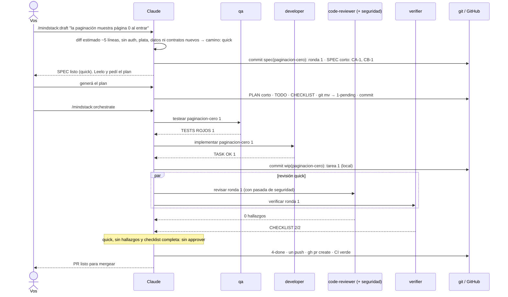

# 09 · Un cambio chico: camino quick

Un pedido chico y sin riesgo no pasa por todo el ritual. `/draft` lo detecta solo, escribe un SPEC corto y la revisión es de dos agentes. Las reglas: `skills/workflow/references/analyze.md › Camino`.

Si el pedido llega con el PR ya abierto y no cambia ningún `CA-n` ni `CB-n` ("renombrá esta variable"), es un retoque: `/draft` deja SPEC y PLAN en el mismo turno y vos solo corrés `/mindstack:orchestrate`.
